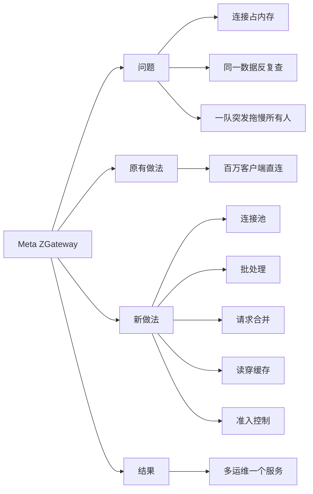

## Q
**Meta ZGateway · 这个案例的地图**｜通览

Meta ZGateway 的问题是什么，原来怎么做，加了什么，每一项各对付什么？

## A
**一句话。** 超过一百万台客户端直连 ZippyDB，连接和重复请求把它压垮；Meta 在中间加反向代理 ZGateway，用五项技术在请求到达存储前先收敛。

**关键直觉。**
- **先看数据库的资源花在哪，再挑技术：** 建连接开销大用连接池，同键同时重复读用合并，不同键的小查询用批处理，读极多又几乎不变用缓存，一个团队打满库用准入控制。
- **合并只发生在同一进程内：** 一次查找 5 ms 时单台网关对同一键最多约 200 次/秒；50 台网关随机分流，上限变成约 1 万次/秒，所以要按键路由或加缓存补。
- **准入控制要按用例分有界队列轮流服务：** 灌满队列的只影响自己；队列无界只是把过载藏起来。

**容易漏的细节。**
- **被拒后立刻重试会放大过载：** 三层调用链每层最多重试 3 次，最底层最坏承受 64 倍流量；要指数退避加抖动，并限制重试占比。
- **共享连接池不能再依赖连接级状态：** 事务、会话变量会泄漏给下一个客户端，慢请求还会造成队头阻塞；网关本身要多实例，否则成了新的单点。
