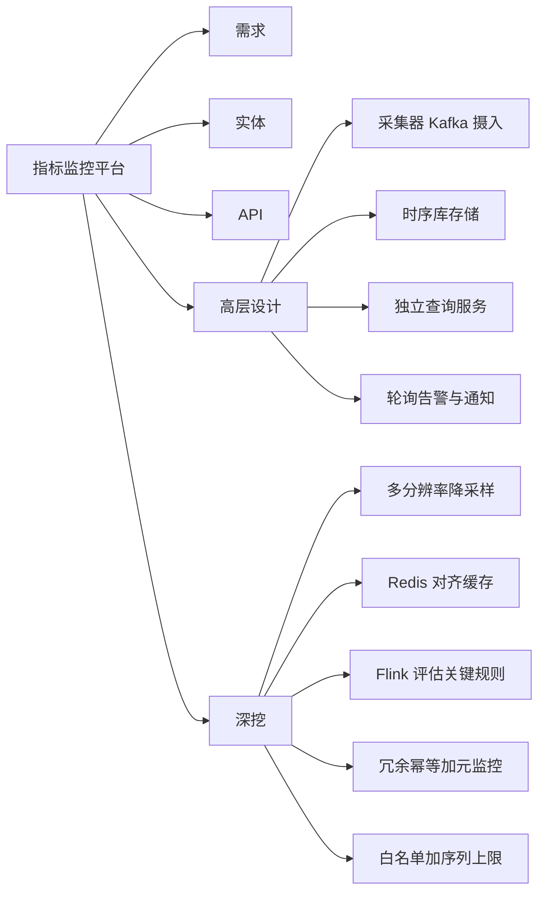

## Q
**指标监控平台 · 这道题的地图**｜通览

指标监控先定哪些约束？写入、查询、告警、基数靠哪几个直觉撑住？

## A
**一句话。** 难点是写入极重（每秒 500 万个数据点）、读取突发、告警又必须可靠。答案是本机采集器加 Kafka 摊平写入，时序库存储，降采样加缓存服务查询，告警先用定时查询。

**先定下的约束。**
- **范围外：** 日志、追踪、ML 异常检测。
- **非功能需求：** 50 万台服务器每 10 秒各发 100 点；仪表盘查询秒级；告警小于 1 分钟；仪表盘容忍最终一致，告警必须可靠；容忍迟到乱序。
- **核心实体：** 指标、标签、序列，另有告警规则与仪表盘。
- **API：** `POST /metrics/ingest`、`GET /metrics/query`、`POST /alerts/rules`。

**关键直觉。**
- **降采样绕不开，但百分位不能平均：** 每点 150B，原始留 15 天近 1PB；平均值还原不出 p99，延迟指标要存直方图或草图。
- **监控宁可丢旧数据也别落后：** 追赶时间 = 停机时长 × u ÷ (1−u)，90% 利用率下 5 分钟事故要约 45 分钟。
- **告警延迟主要是持续时间：** 持续 5 分钟的规则，轮询间隔 60 秒改 15 秒只省 45 秒，查询负载 4 倍；只有关键规则才上 Flink。
- **基数是各标签取值数的乘积：** 加一个用户 ID 就能压垮存储，所以在摄入层强制白名单和序列上限。

**容易漏的细节。**
- **缓存键要对齐步长：** 范围起止每次都变，命中率近 0；取整到步长才能共用。
- **不能用自己监控自己：** 用独立系统加心跳告警。
