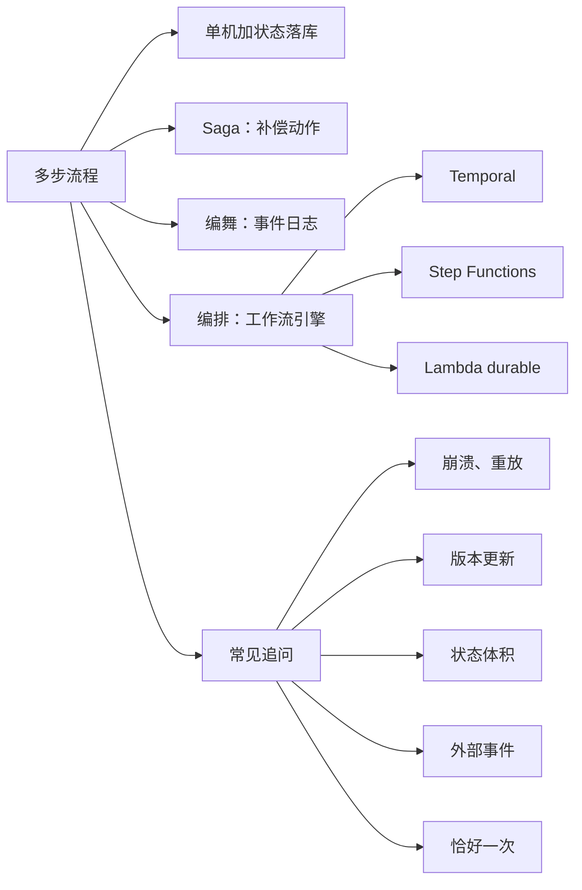

## Q
**多步流程 · 这一章的地图**｜通览

多步流程这一章要解决什么问题？有哪几块，靠哪几个直觉串起来？

## A
**一句话。** 一串会失败、会等待的服务要串成可靠的流程。答案是让工作流引擎保存进度并负责补偿，不要自己手写。

**关键直觉。**
- **每一档都在补上一档缺的东西：** 落库只记进度不会行动，saga 补上撤销，编舞补上容错，引擎补上崩溃后自己接着跑。
- **难点不是顺序而是崩溃后知道做到哪：** 编舞和编排都要在崩溃、重试、补偿之间存状态，这一块最不该手写。
- **不用两阶段提交是因为等不起：** 它要所有参与者持锁等最慢的，协调者卡住全卡住，支付网关也不认；saga 换成每步各自提交加可补偿。
- **效果恰好一次靠两层：** 引擎只保证尝试至少一次，所以 Activity 要幂等，Workflow 要确定，两边各守一条。

**容易漏的细节。**
- **补偿不是回滚：** 它是新的业务动作（退款是又一笔交易），已发出的通知抹不掉；补偿自己也会失败，要有重试、幂等和人工兜底。
- **Saga 放弃了隔离：** 中间状态别人看得到，用"待处理"这类语义锁或只在终态读来应对。
- **幂等键残留窗口：** 动作做完、写 COMPLETED 前崩溃，重试看到 IN_PROGRESS 时别盲目重发，要向下游对账。
- **双写要用发件箱：** 业务变更和待发事件写进同一个数据库事务，否则事件可能丢或虚发。
