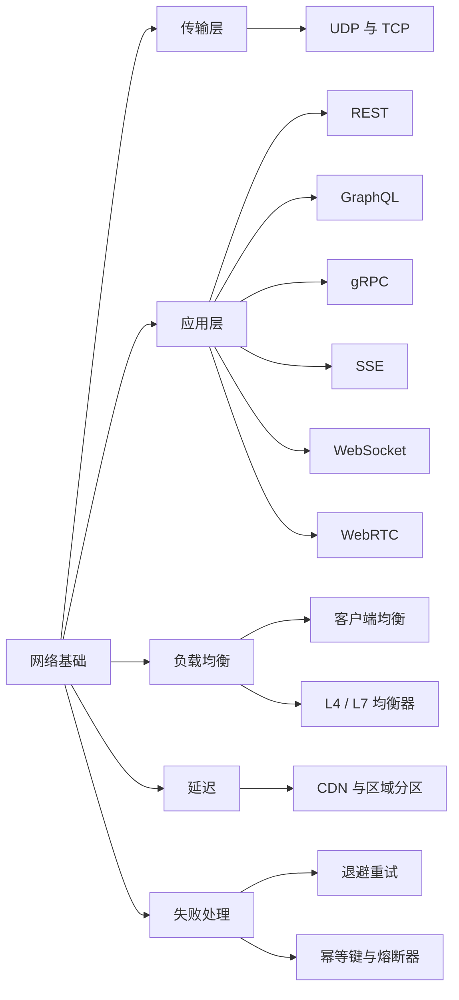

## Q
**网络基础 · 这一章的地图**｜通览

网络基础要解决什么问题？有哪几块，靠哪几个直觉串起来？

## A
**一句话。** 分布式系统的组件靠网络相连，要选对协议、把流量分到多台机器，并为延迟和失败做准备。

**关键直觉。**
- **长连接把状态带进了基础设施：** WebSocket 和 SSE 连接绑在一台服务器上，所以要最少连接均衡、要存"用户在哪台服务器"、要心跳和排空。
- **L4 和 L7 差在看不看内容：** L4 只按 IP 和端口转发，快；L7 读 URL 和 Cookie 才能路由，但更耗 CPU，会话保持还让服务器变有状态。
- **延迟有物理下限：** 纽约到伦敦往返约 56ms，只能让数据靠近用户，或减少串行往返。
- **重试要幂等，而且只在一层做：** 三层各重试三次，最底层最坏收到 64 次请求；退避加抖动、重试预算和熔断器一起止血。

**容易漏的细节。**
- **HTTPS 不等于请求体可信：** 身份要取自验证过的令牌，不取自请求里的字段。
- **DNS 故障切换不是瞬时的：** 要等 TTL，且普通 DNS 不探测健康。
- **HTTP/2 仍有队头阻塞：** TCP 丢一个包，所有流都等；HTTP/3 的 QUIC 建在 UDP 上，各流独立。
