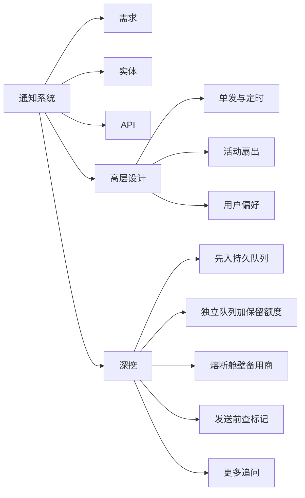

## Q
**通知系统 · 这道题的地图**｜通览

通知系统先定哪些约束？不丢、5 秒和去重靠哪几个直觉撑住？

## A
**一句话。** 这是内部平台题，系统只是路由器加记账员，最后一公里归服务商。难点是洪峰：接受的通知不能丢，验证码要在大促里 5 秒送到，至少一次投递之上还要尽量不重复。

**先定下的约束。**
- **范围外：** 模板管理、数据看板、站内信、频率上限。
- **非功能需求：** 日均 1000 万条，洪峰按每秒 5000 条设计；至少一次加尽力去重；高优先级接受后 5 秒内送出。
- **核心实体：** 通知、活动、人群、用户。
- **API：** `POST /notifications`（含渠道、优先级、可选定时）、`POST /campaigns`、偏好、设备令牌。

**关键直觉。**
- **日均值没有信息：** 日均每秒只有一两百条，但一个 300 万条的活动 10 分钟发完就是 5000 条/秒，吃满额度，共用队列里的验证码要等约 10 分钟。
- **天花板是服务商，不是我们的算力：** 200 万条要 5 秒送完需 40 万条/秒，加机器无效；办法是验证码不排在积压后面：独立队列，加服务商额度里的保留份额。
- **服务商变慢，吞吐掉得比延迟涨得快：** 400 并发时延迟 0.4 秒到 30 秒，吞吐从 1000 条/秒掉到约 13；要靠舱壁和熔断。

**容易漏的细节。**
- **优先级是自报的：** 没有按调用方的配额就会通胀。
- **免打扰跨午夜：** `22:00 <= now < 08:00` 永远为假，要分情况判断。
- **SENT 只表示服务商接受：** 送达和退信靠回调，无效设备令牌要删。
