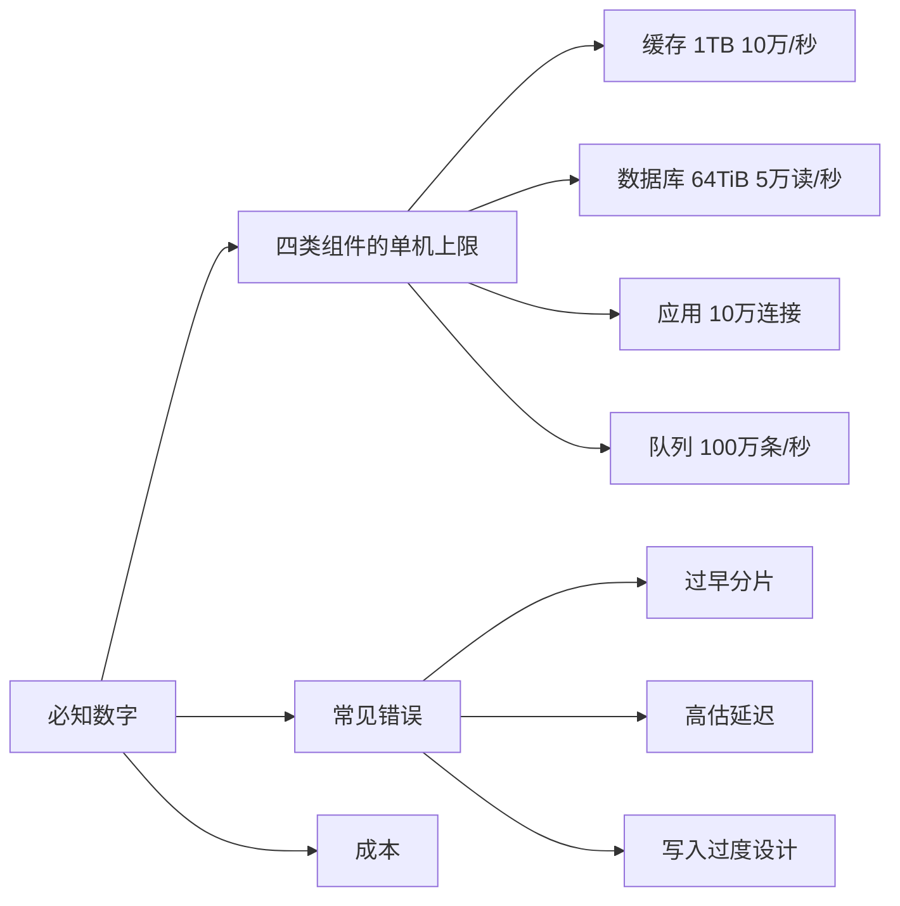

## Q
**必须知道的数字 · 这一章的地图**｜通览

必须知道的数字要解决什么问题？有哪几块，靠哪几个直觉串起来？

## A
**一句话。** 用几年前的数字估算会得出过度设计的系统，要换成现代硬件的真实上限，再用它们判断分片、缓存、队列要不要上。

**关键直觉。**
- **先算数，再决定加不加组件：** 540 GB 的数据单库放得下，不分片；聊天 330 TB 要分片，触发的是存储，不是写吞吐。
- **每个数字配一个扩容信号：** 命中率低于 80%、内存超 80%；写持续超 1 万 TPS、数据近 50 TiB；CPU 超 70% 到 80%；队列近 80 万条/秒或积压增长。对照阈值，健康的组件不动。
- **有索引的简单查询已经够快：** 亚毫秒到几毫秒，为降延迟加缓存多半多余；联接和聚合这类重查询才值得缓存。
- **副本管高可用，分片管容量：** 单实例不等于单点，主库加读副本照样要有。

**容易漏的细节。**
- **延迟变慢会放大并发：** 并发等于到达率乘停留时间（利特尔法则）；下游从 80 毫秒变 800 毫秒，同样 5000 次/秒的并发涨十倍，线程耗尽就是雪崩。
- **队列的 100 万条/秒是最好情况：** 小消息批量发送；`acks=all` 加多副本要打折。
