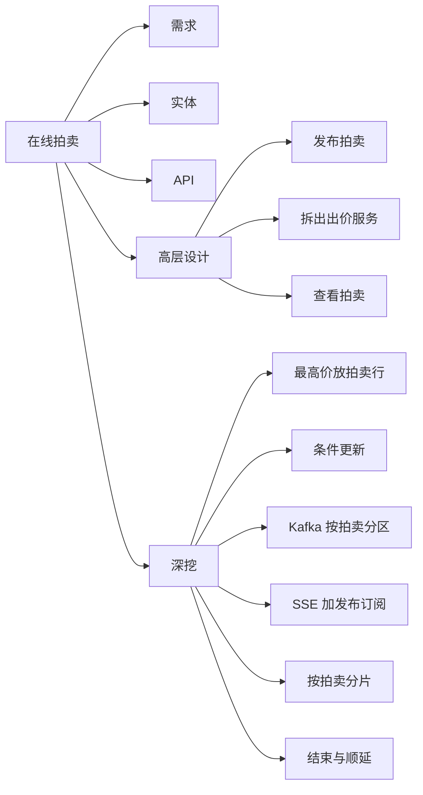

## Q
**在线拍卖 · 这道题的地图**｜通览

在线拍卖先定哪些约束？一致、不丢、实时靠哪几个直觉撑住？

## A
**一句话。** 多人抢同一场拍卖的最高价，既不能丢出价，也不能让两人同时被接受，还要让观众实时看到；核心是把比较并更新最高价做成一个原子操作。

**先定下的约束。**
- **范围外：** 搜索、分类过滤、价格排序、拍卖历史。
- **非功能需求：** 出价强一致；不丢出价；最高价实时显示；扩展到 1000 万场并发拍卖。
- **核心实体：** Auction、Item、Bid、User；Item 单独成表。
- **API：** `POST /auctions`、`POST /auctions/:id/bids`、`GET /auctions/:id`。

**关键直觉。**
- **锁出价行挡不住新插入：** 首次出价时一行都没锁到；最高价放进拍卖行，对这一行做条件更新。
- **总写入不大，难在同一行争用：** 约 1650 条/秒，峰值约 1.5 万；同一拍卖进同一分区，由一个消费者串行处理。
- **Kafka 确认不等于出价被接受：** 它只说明已持久；接口返回 202 加出价号，结果再推给用户。
- **推送只是提示：** 重连先查一次当前价，再接着听；推送丢了也只是晚一点。

**容易漏的细节。**
- **缓存只能拒绝，不能接受：** 最高价只升不降，所以不高于缓存值的出价可直接拒。
- **结束和最后一秒出价会抢：** 条件里同时带状态和结束时间，时间用数据库自己的。
- **热拍卖推送反而更贵：** 5 万观看者、每秒 5 条新价，比 3 秒轮询多约 15 倍；每连接每秒合并推一次。
