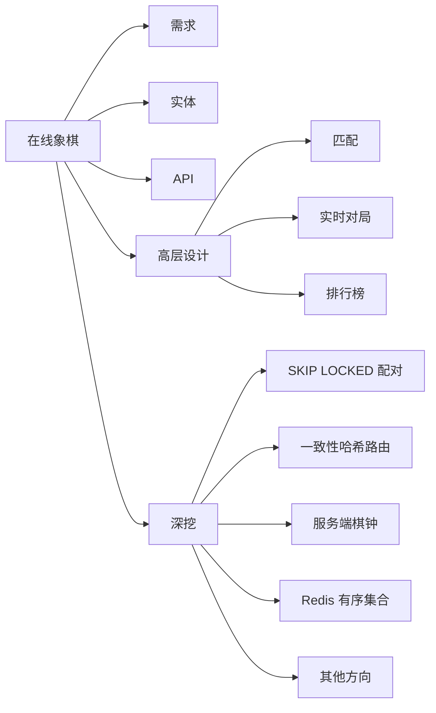

## Q
**在线象棋 · 这道题的地图**｜通览

在线象棋先定哪些约束？匹配、路由、棋钟、榜单靠哪几个直觉撑住？

## A
**一句话。** 难点是一局棋要有唯一的权威所有者：服务端持有棋盘和两块棋钟，客户端只提交走法。匹配、对局、排行榜是三条相对独立的路径，各有一个深挖。

**先定下的约束。**
- **范围外：** 观战、聊天好友、谜题复盘、锦标赛、反作弊。
- **非功能需求：** 三分钟闪电战；1000 万注册玩家，50 万局并发即 100 万连接；走子低于 200ms；一致性优先于可用性。
- **核心实体：** Player、Game、Move、MatchRequest。
- **API：** 匹配与榜单用 REST（`POST /matchmaking`、`GET /leaderboard`），对局用 WebSocket `/games/:gameId`。

**关键直觉。**
- **宁可漏配一次，也不重复配对：** 先锁自己的请求，再用 SKIP LOCKED 挑对手；不加它，要么互等死锁，要么并发匹配排成一队。
- **一致性哈希只减少搬家，不代替所有权：** 20 台变 21 台，取模约 95% 的局换地址，一致性哈希约 5%；换主还要纪元号挡住旧主的写入。
- **封顶补偿帮不了远处的人：** RTT 远超封顶时，补偿几乎无效；解药是把服务器放近玩家。
- **先问要名次还是百分位：** 前 50 名靠 rating 索引，百分位用分段计数，只有精确名次才需要 Redis。

**容易漏的细节。**
- **发布订阅发完即忘：** 断线重连不会补发，轮到他时屏幕还停在旧步而钟在走；重连要主动拉最新状态。
- **8000 次匹配请求每秒不等于要换 Redis：** 按平均 2 分钟一局算，带索引的 Postgres 先够用。
