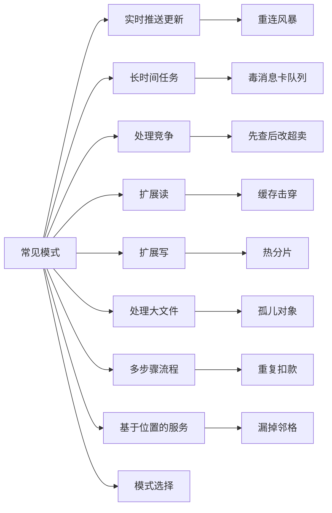

## Q
**常见模式 · 这一章的地图**｜通览

常见模式要解决什么问题？有哪几种，选用时靠哪几个直觉？

## A
**一句话。** 模式是问题形状加成熟解法加已知的坑；认出模式既省时间，又能一眼点出典型失败。

**关键直觉。**
- **每个模式都先试最简单的一档：** 实时更新先轮询，竞争先用单库原子更新，位置先全部扫一遍，长任务够短就同步做；有具体信号才升级。
- **升级的信号是数字或需求：** 延迟目标低于轮询间隔，或空轮询压垮服务器；读写比超过 100:1；10 万人抢 100 张票时乐观重试冲突率极高，悲观锁反而更稳。
- **读先成为瓶颈，所以顺序是库内、副本、缓存：** 先索引和反规范化，再读副本，最后外部缓存；每一档都带来新坑，如缓存失效、复制延迟、热点键。
- **模式会叠加：** 视频平台同时用大文件、长任务、实时通知和多步流程，难点常在叠加处，例如位置索引里的"空闲"可能已过期，最终要回到权威状态判定。

**容易漏的细节。**
- **推送把成本从请求数变成连接数：** 轮询 100 万用户每 5 秒一次约 20 万 QPS；长连接则受内存和文件描述符限制。
- **位置索引的格子要匹配查询半径：** 格子太大过滤成本高，太小要查很多格；查询要同时取目标格和邻格再按真实距离过滤。
