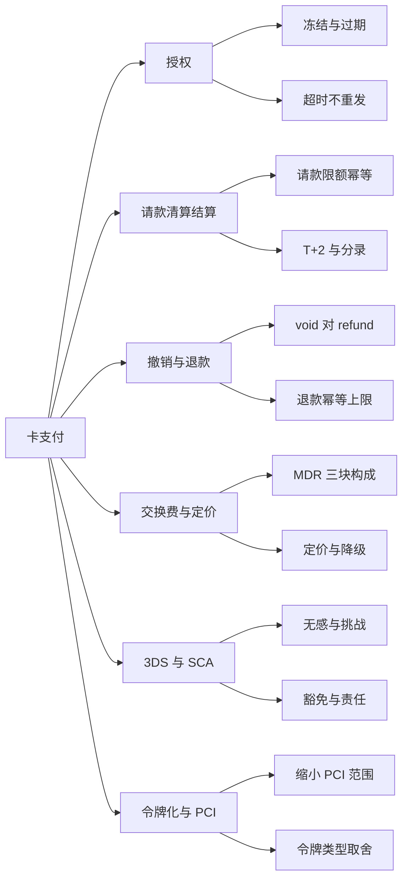

## Q
**卡支付生命周期 · 这一章的地图**｜通览

卡支付生命周期要解决什么问题？有哪几块，靠哪几个直觉串起来？

## A
**一句话。** 一笔卡交易分成授权、请款、清算结算几步，每步钱走到的位置不同，取消、收费、认证和存卡的做法都跟着变。

**关键直觉。**
- **钱走到哪一步，动作就变：** 未请款用撤销，免费且即时；已请款只能退款，慢且手续费通常不退。
- **每一步外部结果都可能未知：** 授权超时不能发新授权，要用同一请求号查询，否则双重冻结。
- **出钱的动作要幂等加上限：** 请款累计不超授权，退款累计不超请款。
- **认证换来责任转移：** 3DS 成功后欺诈类拒付归发卡行，代价是转化率；用豁免则责任留在商户。

**容易漏的细节。**
- **授权会过期：** 授权约 7 天过期，发货拖到第 9 天，请款失败，要在到期前重新授权。
- **数据影响费用：** 漏传 Level 2 数据，交易被降级到更贵的费用类别，没有任何报错。
- **令牌绑定：** PSP 金库令牌无法导出，换 PSP 时已绑卡全部失效。
