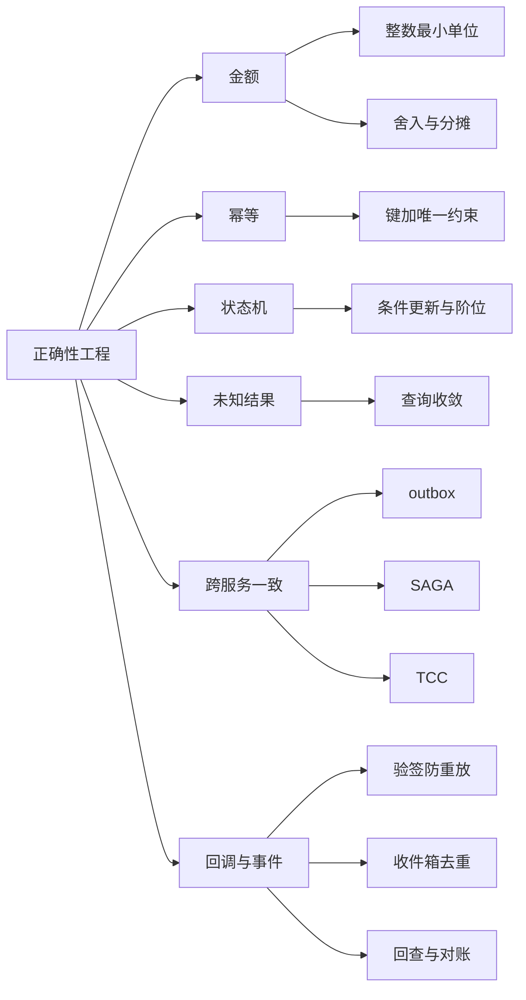

## Q
**正确性工程 · 这一章的地图**｜通览

支付的正确性工程要解决什么问题？有哪几块，靠哪几个直觉串起来？

## A
**一句话。** 重复、超时、乱序、丢失在支付里天天发生，而外部扣款回不去；办法是让每一步都能重试、能补偿、能对账，最终收敛到一致。

**关键直觉。**
- **只求最终一致：** 外部扣款没法回滚，只能退款补偿，所以不追求 2PC 那种全局原子。
- **原子边界越小越好：** 支付单状态、分录、幂等记录、outbox 放同一个库同一个事务。
- **最终裁决在数据库：** 幂等记录、收件箱、状态转移都靠唯一约束或条件更新；缓存和分布式锁只降低重复概率。
- **外部消息只是提示：** webhook 会重、乱、丢、可伪造，以回查 PSP 当前状态和对账为准。

**容易漏的细节。**
- **重试里换键：** SDK 重试时重新生成键会重复扣款；键要在首次发送前存下。
- **舍入点会差一分：** 手续费 2.9%，三笔 0.50 美元，逐笔舍入合计 0.03，汇总舍入是 0.04。
