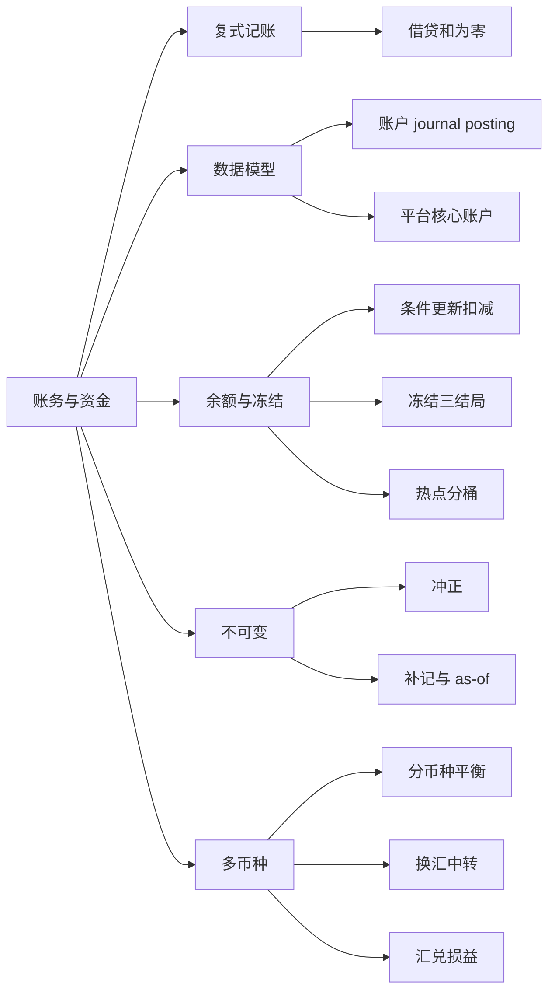

## Q
**账务与资金 · 这一章的地图**｜通览

支付的账务与资金要解决什么问题？有哪几块，靠哪几个直觉串起来？

## A
**一句话。** 一个余额字段追不到来源、会并发丢更新、钱会凭空出现；办法是只追加的复式账本，每笔业务借贷相等，余额由分录汇总得出。

**关键直觉。**
- **余额只是分录的投影：** 分录是唯一真相，余额字段是缓存，与分录同事务更新并定期重算。
- **平衡不等于正确：** 漏掉一对抵消的行或放错账户同样平衡，要靠分录模板和对账发现。
- **错了只能追加：** 冲正方向取反并指回原单；已关账的期间不回写，在当期追加调整。
- **币种互不相加：** 每个币种各自平衡，换汇经每币种一个的中转账户连接两边。

**容易漏的细节。**
- **待结算和可提现要分开：** 混在一个账户里，拒付后商户已提走的钱就成了缺口。
- **未知结果的冻结不能到期自动释放：** 银行可能已经出账，释放后用户会再花一次。
