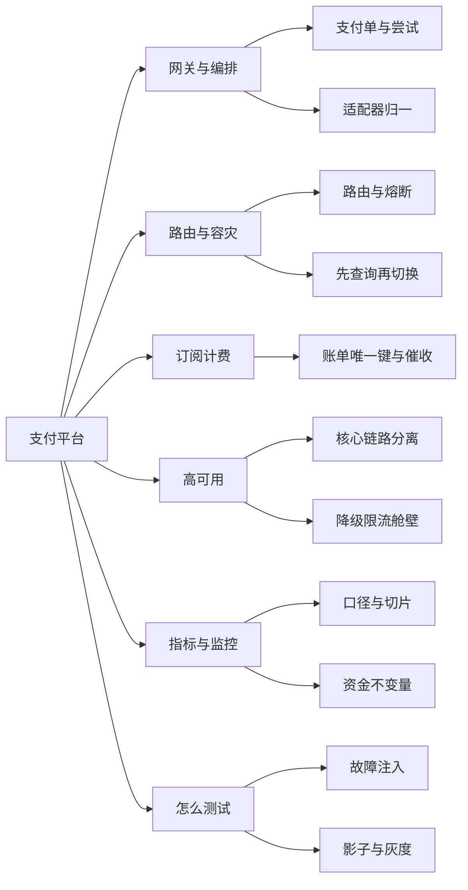

## Q
**支付平台架构 · 这一章的地图**｜通览

支付平台架构要解决什么问题？有哪几块，靠哪几个直觉串起来？

## A
**一句话。** 业务只认统一模型，渠道的差异和故障被挡在窄边界内，再用高可用、监控和测试保证一件事：结果未知时钱也不出错。

**关键直觉。**
- **未知结果不等于失败：** 适配器、切换渠道、订阅重试、测试用例都围着这一条，错了就是重复扣款。
- **差异收在一层：** 只有适配器认识渠道，所以新增渠道只增不改，业务代码不动。
- **每层只承担有限损失：** 舱壁、熔断、限流让故障不跨边界，代价是新请求的吞吐。
- **测的是异常路径：** 沙箱总是快速成功，超时、重复、乱序要靠模拟器注入。

**容易漏的细节。**
- **重试风暴：** 三层各重试 3 次，最坏对渠道放大 64 倍；只在一层重试。
- **聚合指标会稀释局部故障：** 大盘 98%，占 2% 流量的某国 Pix 掉到 40%，整体仍有 96.84%，阈值设 95% 不会响。
