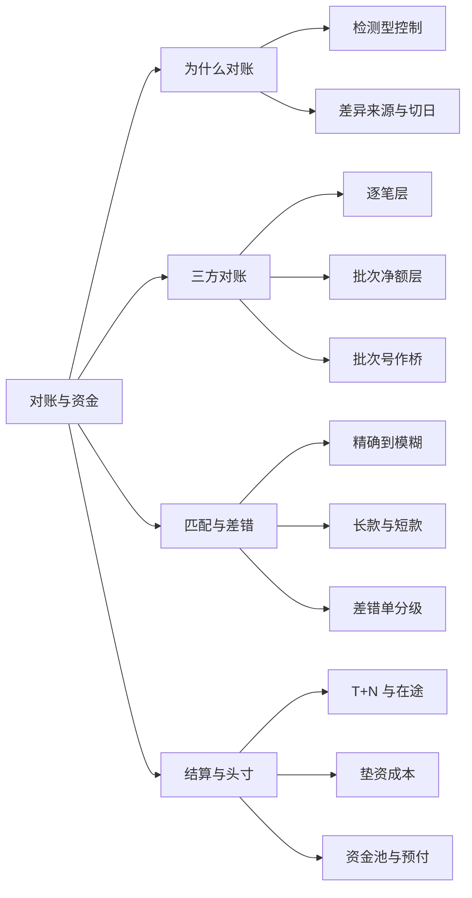

## Q
**对账、结算与资金管理 · 这一章的地图**｜通览

对账、结算与资金管理要解决什么问题？有哪几块，靠哪几个直觉串起来？

## A
**一句话。** 钱的最终真相在系统之外，所以要拿渠道和银行的独立记录分层核对内部账，再管好钱到账前后的时间差。

**关键直觉。**
- **错误一定会漏网：** 幂等和状态机降低概率，规模乘上去仍有差异，所以要有一道检测。
- **每层只比同颗粒度的记录：** 银行一条入账对应几百笔交易，直接比到底无从定位。
- **自动化只处理外部事实已明确的差异：** 要靠猜的匹配只能给建议，不能直接入账。
- **承诺越快，垫的钱越多：** 垫资约等于日应付额乘提前天数，成本与天数成正比。

**容易漏的细节。**
- **假差异比真差异更危险：** 我方按北京时间、渠道按 UTC 切日，约三分之一交易对不上，运营批量关单，真错账一起被淹没。
- **渠道单方的小额扣款最难发现：** 拒付、调账的回调丢了，只有文件对账看得见。
