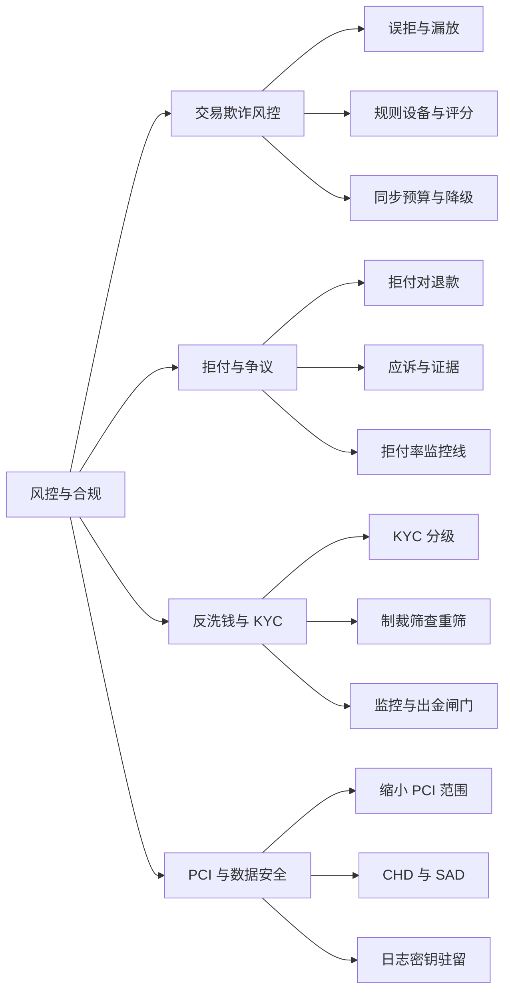

## Q
**风控与合规 · 这一章的地图**｜通览

风控与合规要解决什么问题？有哪几块，靠哪几个直觉串起来？

## A
**一句话。** 支付平台既要在毫秒内挡住欺诈，又要承担事后拒付、反洗钱和卡数据安全的责任，办法是把控制点放在资金进出和数据经手的地方。

**关键直觉。**
- **目标是总成本最小：** 严防欺诈会多误拒，一例里误拒损失的毛利 20 万，比欺诈损失 15 万还高。
- **拒付是滞后指标：** 问题在一两个月前就已发生，所以要提前留证据，并盯退款率、投诉这类领先信号。
- **合规结论会过期：** 筛查要在开户、打款前、名单更新后重复做，闸门放在出金之前，因为打款发出就难追回。
- **最安全的数据是没有的数据：** 卡号不经过自家服务器，范围和成本差一个数量级。

**容易漏的细节。**
- **CVV 授权后不能存：** 加密也不行，它只用于授权时证明持卡人在场。
- **试卡会拉垮成功率：** 平时每小时 1 万次尝试，试卡多出 5 万次，成功率从 92% 掉到 17%。
- **一行调试日志拉大范围：** 打印请求体里的卡号，日志平台和数仓全进 PCI 范围。
