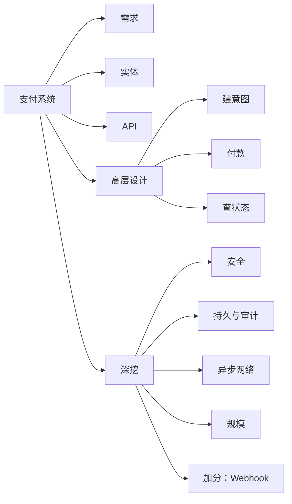

## Q
**支付系统 · 这道题的地图**｜通览

支付系统这道题按什么顺序讲？每一步的要点是什么？

## A
**一句话。** 难点是外部支付网络又慢又不可信：既要卡数据不泄露、记录不丢，又不能在超时时重复扣款。答案是不可变事件流，加先记录再调用，加自动对账。

**先定下的约束。**
- **范围外：** 保存卡、退款、报表、订阅扣款、给商户打款。
- **非功能需求：** 高度安全；数据不丢且可审计；外部网络异步下资金一致；峰值约 10,000 笔/秒。
- **核心实体：** Merchant、PaymentIntent（一个意图对多条 Transaction）、Transaction。
- **API：** `POST /payment-intents`、`POST /payment-intents/{id}/transactions`、`GET /payment-intents/{id}`。

**关键直觉。**
- **超时不等于失败：** 钱可能已经扣了，所以调网络前先记尝试，状态只在拿到权威答复（引用号查询、结算文件）后才进终态。
- **幂等有两层：** 商户到我们靠 (商户ID, 幂等键) 唯一约束，我们到网络靠自己的引用号；同键不同请求体要拒绝。
- **事件由库产生：** CDC 从数据库日志读变化，提交即入流，Webhook、对账、审计都是它的消费者，不靠代码记得发。

**容易漏的细节。**
- **按商户分片有热点：** 占 40% 流量的大商户在 10,000 TPS 下是 4,000 TPS，全压一个分片；改按意图哈希或拆桶，代价是商户维度查询要跨片。
- **分区数按事件算：** 每笔约 3 个 CDC 事件，即 30,000 条/秒，每分区按 5,000 条/秒至少 6 个。
