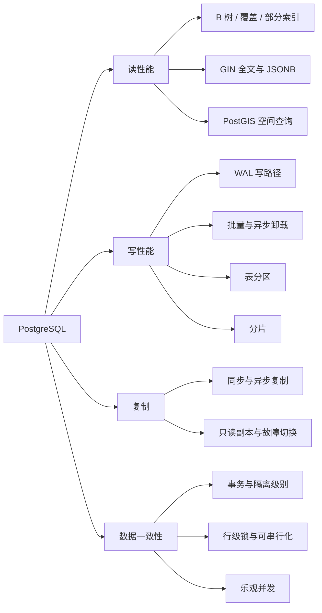

## Q
**PostgreSQL · 这一章的地图**｜通览

PostgreSQL 靠哪几块撑到很大规模？读、写、复制、一致性之间靠什么直觉串起来？

## A
**一句话。** 要一个关系复杂、一致性要求不一的数据层，PostgreSQL 靠索引、复制、分区和事务撑到很大规模，极端写入和全球多主才换别的库。

**关键直觉。**
- **写吞吐卡在提交时的 WAL 刷盘：** 读在内存里就能完成，写必须等 WAL 落盘，索引还要多写一遍，所以先批量、卸载，最后才分片。
- **分区和分片治的不是一个病：** 分区解决数据太大，留在单机；分片解决单机写不动，代价是自己管跨分片查询。
- **复制在持久和延迟之间选：** 异步最快但切换会丢最近的写，同步不丢但每次提交多等一次往返；读副本还会让用户读不到自己刚写的数据。
- **并发保护要对准具体的竞争：** 知道锁哪一行用行级锁，不知道就用可串行化加重试；只说“它是 ACID 的”不算答案。

**容易漏的细节。**
- **自动切换怕脑裂：** 旧主没死只是网络分区时，两边都接受写入；要有围栏和共识存储里的主租约。
- **更新密集的表会膨胀：** MVCC 留下死元组，长事务挡住 VACUUM 清理。
