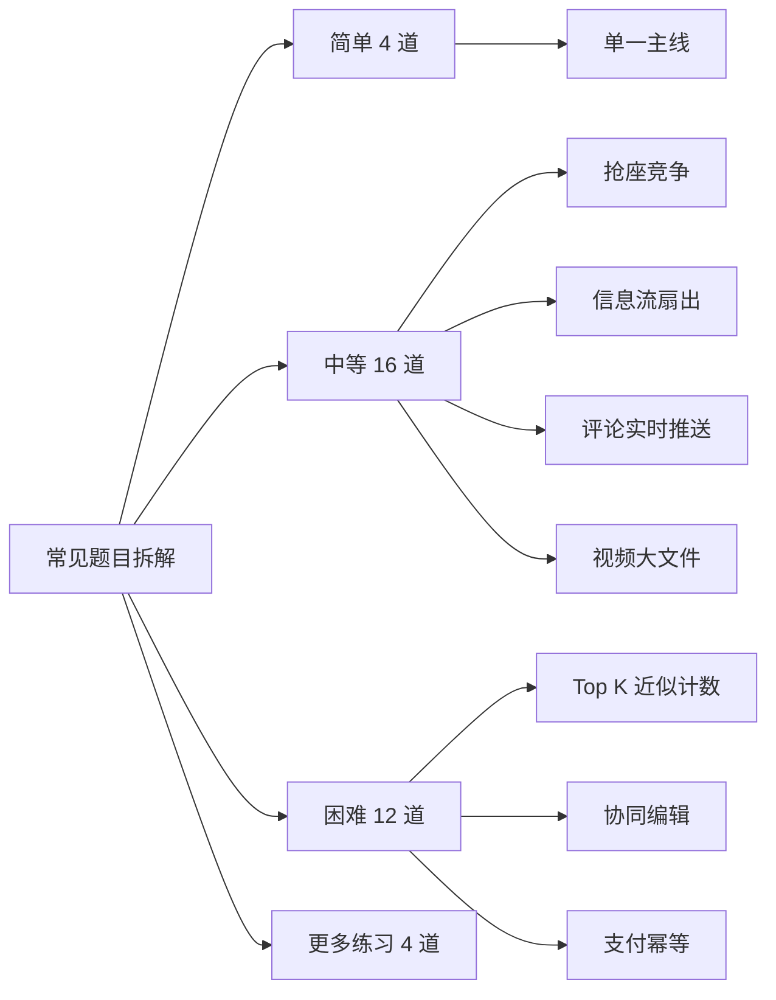

## Q
**常见题目拆解 · 这一章的地图**｜通览

常见题目拆解怎么分档？一道没见过的题，怎么靠已练过的题起手？

## A
**一句话。** 32 道常见题按难度分三档，每道考不同的核心点；另有 4 道只有引导练习的真题。多数题是少数几个模式的不同组合。

**关键直觉。**
- **看瓶颈，不看题名：** 先问唯一的资源是什么、谁在争它、规模多大；拍卖和抢购同是有限资源被同时争，差别是抢购瞬时尖峰、拍卖持续一段且要实时推送。
- **差异才是考点：** 说"这和我熟悉的 X 同构，区别在 Y"，把时间花在 Y 上。
- **一道题可以拆成已练过的片段：** 没练过的排行榜，借 Game Leaderboard 的有序集合，借 Dropbox 的离线上传，借实时更新模式；别从零发明。
- **补弱项按模式选题：** 卡在占座过期与超卖，就找同一能力的放大或变体，如 Flash Sale、Online Auction、Uber，每道只盯竞争这一个深入点。

**容易漏的细节。**
- **难度档不等于模式难度：** 同一个竞争模式，在 Payment System 里变成重复请求，要靠幂等和状态机，不是锁。
- **简单题适合先走完整个交付框架：** 单一主线，用来建立节奏，再往中等和困难走。
