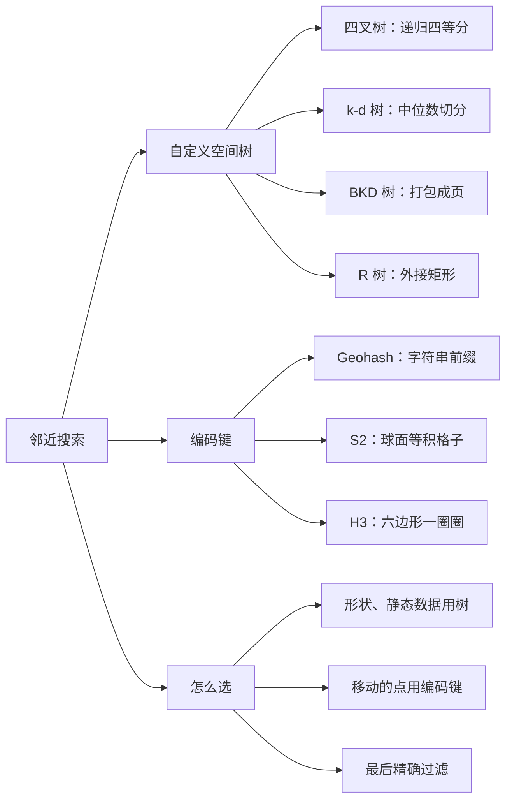

## Q
**邻近搜索 · 这一章的地图**｜通览

邻近搜索怎么让二维的“附近”也能走索引？树和编码键各凭什么，怎么选？

## A
**一句话。** 普通索引只能按一维排序，保不住二维的远近；办法是自定义空间树，或把位置压成可排序的键，先取候选再精确过滤。

**关键直觉。**
- **索引只给候选，不给答案：** 格子和矩形都比真实的圆大，所以每种做法最后都要按精确距离过滤；索引的价值是把候选缩到几千行内。
- **选结构看数据怎么变：** 移动的点一次更新只改一个整数，不动树；树和 BKD 块基本写一次，位置频繁更新会让写放大。
- **格子大小要和半径配套：** 格子边长不小于查询半径，本格加邻格才盖得住；越小查询的格子越多，越大后过滤越重。
- **编码键换来的是能用任何库：** 位置变成整数或字符串后，Redis、普通 B 树索引直接可用，不必依赖专用的空间索引。

**容易漏的细节。**
- **Geohash 边界漏人：** 路口两侧前缀可能完全不同，只扫自己的前缀会漏掉隔壁格的司机，要查九宫格。
- **经度方向的格子随纬度收窄：** 5 字符的格子赤道约 4.9 km 宽，北纬 60 度约 2.45 km。
- **按格子分片会有热点：** 市中心一个格子几千司机，沙漠是零。
