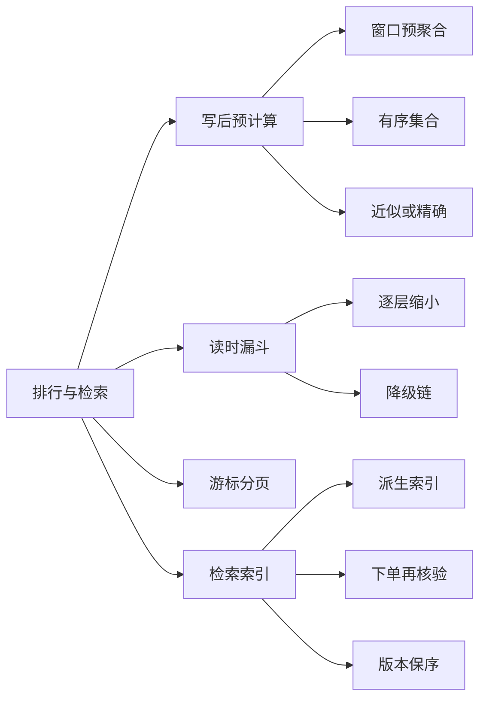

## Q
**排行与检索 · 这一章的地图**｜通览

排序和搜索筛选要解决什么问题？有哪几块，靠哪几个直觉串起来？

## A
**一句话。** 排序和搜索都不在原始数据上现算：把排序成本挪到最便宜的地方，搜索只查为读优化的派生索引，正确性留给写路径。

**关键直觉。**
- **先问榜是不是人人相同：** 相同就写后预计算，查询只读结果；每人不同就读时对几百个候选逐层排，默认时间序的流干脆不排。
- **分片前 K 能归并，靠按对象 ID 分区：** 同一对象只在一片里，全局前 K 才一定在各片前 K 的并集里。
- **先问精确还是近似：** 这个选择会换掉整套架构；趋势榜可近似，涉及奖励或名次纠纷必须精确。
- **索引可以过期，写路径不能错：** 索引丢了能从真相重建，超卖和错价只在下单处挡。

**容易漏的细节。**
- **分数不用累加：** 判题重试会重复报告，`ZINCRBY` 会加两次；重算后 `ZADD` 覆盖，罚时在算分时扣。
- **改价不重建文档：** 价格库存从缓存读出后覆盖，不放进倒排排序的关键路径。
- **过期要说得出上界：** 索引新鲜度几十秒到几分钟，结果带更新时间。
