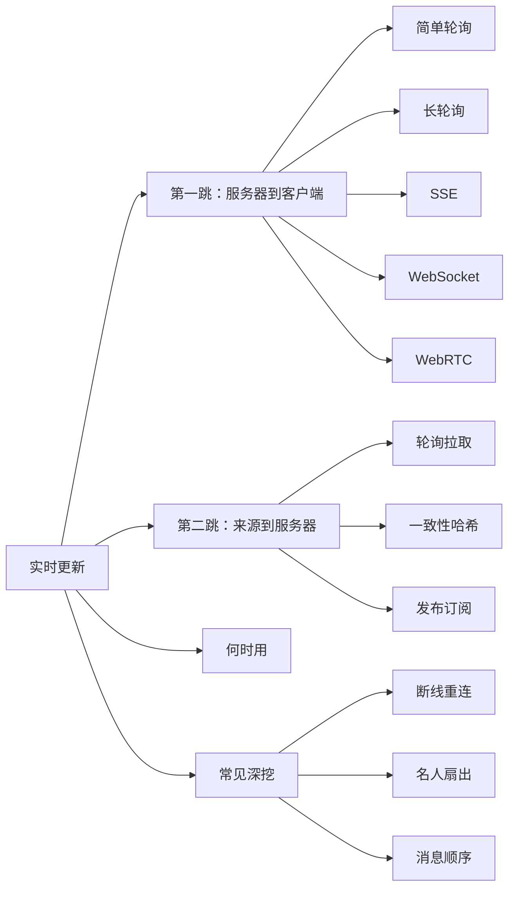

## Q
**实时更新 · 这一章的地图**｜通览

实时更新这一章要解决什么问题？有哪几块，靠哪几个直觉串起来？

## A
**一句话。** HTTP 是请求响应，服务器不能主动说话，办法是把问题拆成两跳：服务器到客户端，来源到服务器。

**关键直觉。**
- **两跳各选各的，但要配得上：** 第一跳选了 WebSocket 这种有状态长连接，第二跳就必须回答"这个用户连在哪台服务器上"。
- **能轮询就两跳都省：** 能接受 2–5 秒延迟时，客户端自己来问，协议和服务端的触发机制都不需要。
- **五种协议答的是同一个问题：** 连接要不要复用、由谁保持、保持多久；越往后延迟越低，要维护的连接状态越多。
- **第二跳选的是状态放哪：** 发布订阅把状态放在中间件，端点服务器可互换；一致性哈希把状态放在端点，路由要协调。

**容易漏的细节。**
- **Redis Pub/Sub 即发即弃：** 订阅者断开期间的消息直接丢，要补发得另写一份可回放的日志（Redis Streams 或 Kafka）。
- **重连风暴：** 一台服务器重启，上面的连接同时重连；指数退避加随机抖动把重试摊开。
- **长连接沿途每一层都要配合：** 负载均衡用 L4 还是 L7，各跳超时要对齐。
