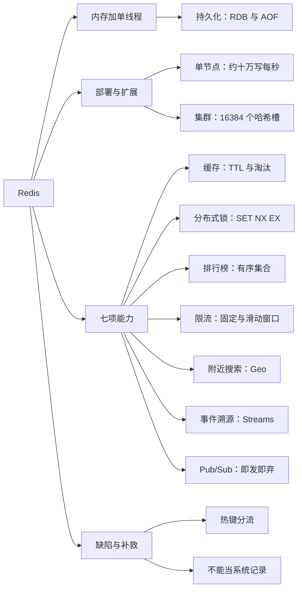

## Q
**Redis · 这一章的地图**｜通览

Redis 为什么快又好推理？它的七项能力、扩展方式和短板怎么串起来？

## A
**一句话。** Redis 把数据结构放在内存里，单线程逐条执行命令，快而简单；面试里拿它做缓存、锁、排行榜、限流等，但不能当系统记录。

**关键直觉。**
- **单线程换来的是每条命令天然原子：** 锁的释放、限流的“数了再设过期”这类复合操作，靠一段 Lua 脚本就变成一条命令；代价是慢命令会堵住所有人。
- **扩展的代价都出在“跨键”上：** 集群按槽分键，跨槽事务直接报错，要用哈希标签把必须一起操作的键放同槽，但标签太粗会造成热点。
- **复制是异步的，所以读副本和主从切换都可能出旧数据：** 刚写完读到旧值、切换后锁被两个人持有，都是同一个原因。
- **三种消息能力按“能不能丢”选：** Pub/Sub 只给在线者，Streams 持久并支持消费者组，长保留多方回放才上 Kafka。

**容易漏的细节。**
- **热键分流要看读写：** 读副本救不了写热点，写入仍只到该槽的主节点；键副本则让写要扇出。
- **锁的租期短于任务时间：** 到期后第二个持有者进入；要续期，并让被保护的数据用围栏令牌拒绝旧持有者。
- **固定窗口限流有边界突发：** 相邻两个窗口的边界上两秒内可放行两倍限额。
