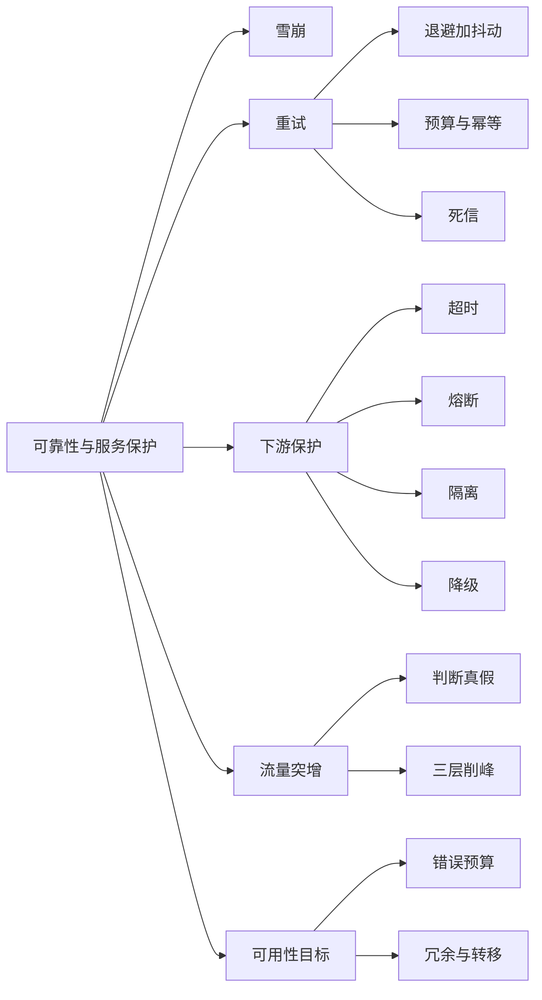

## Q
**可靠性与服务保护 · 这一章的地图**｜通览

可靠性与服务保护要解决什么问题？有哪几块，靠哪几个直觉串起来？

## A
**一句话。** 一个慢依赖会占满上游线程，重试又把流量成倍放大，整条链路跟着雪崩；办法是让失败快速、局部发生，再用 SLO 约定多可靠才够。

**关键直觉。**
- **慢比挂更危险：** 挂了立刻报错，线程释放；慢则线程占着等超时，资源悄悄耗光。
- **重试是乘法：** 每层最多调用 3 次（原请求加 2 次重试），三层嵌套最坏放大 27 倍；只在最靠近故障的一层重试。
- **先挡再扩：** 扩容有冷启动，救不了秒级突发；先判断流量真假，再限流、缓存、排队顶住。
- **冗余只防独立故障：** 同一次发布或同一可用区会同时带走所有副本，并联的六个九算不出来。

**容易漏的细节。**
- **超时不等于失败：** 写请求超时时服务端可能已执行，重试必须带幂等键。
- **同步硬依赖是串联：** 三个 99.9% 的下游，整体最多约 99.7%。
