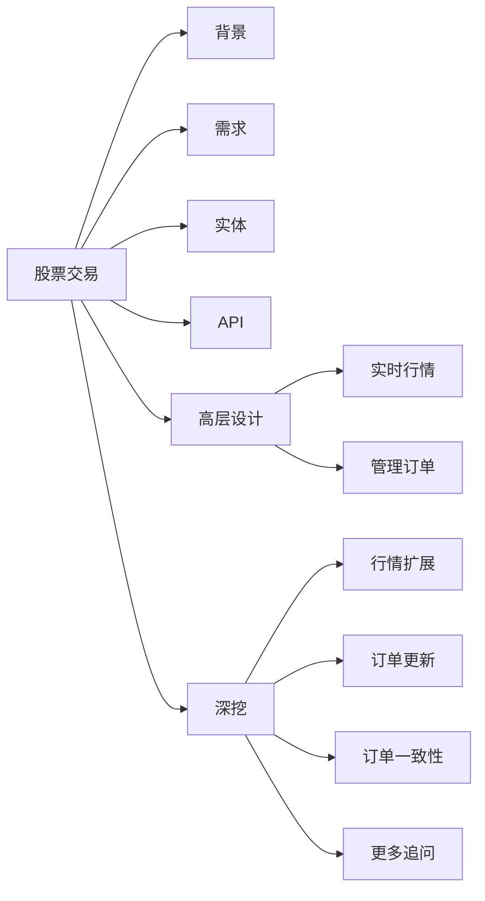

## Q
**股票交易（Robinhood） · 这道题的地图**｜通览

股票交易这道题按什么顺序讲？每一步的要点是什么？

## A
**一句话。** 我们是券商不是交易所，把用户请求代理给外部交易所。难点有两个：把行情推给几百万在线用户，以及订单在我们的库和交易所之间崩溃也不能对不上。

**先定下的约束。**
- **范围外：** 盘外交易、ETF、期权、加密货币、实时盘口。
- **非功能需求：** 订单强一致；2000 万日活、日均约 1 亿笔（全天平均约 1,157 笔/秒）；行情与下单 200ms 内；交易所连接尽量少。
- **核心实体：** User、Symbol、Order。
- **API：** `GET /symbol/:name`、`POST /order`、`DELETE /order/:id`、`GET /orders`；价格用整数分。

**关键直觉。**
- **价格是状态，成交是事件：** 行情丢中间值无损，可用即发即弃的 pub/sub；成交和撤销丢一条就永久不一致，要靠订单库加对账。
- **提交交易所前先存 pending：** 提交不可撤销也不可见，先落库并生成 clientOrderId，崩溃后凭它向交易所查询。
- **冲突时以交易所为准：** 本地状态是缓存；撤单和成交抢跑时终态互斥，用条件更新让只有一个写入者胜出。
- **扇出粒度是服务器订阅符号：** 每符号一个频道，Redis 投递量只随服务器数增长，与用户数无关。

**容易漏的细节。**
- **成交可能先于订单号映射到达：** 查不到会被当成别人的订单；要短重试，再由清理任务兜底。
- **按 userId 分片只便宜用户维度：** 按交易所订单号查要另建映射。
