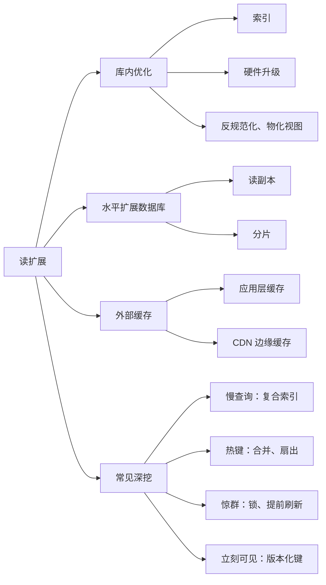

## Q
**读扩展 · 这一章的地图**｜通览

读扩展这一章要解决什么问题？有哪几块，靠哪几个直觉串起来？

## A
**一句话。** 读远多于写，单库会撞到物理极限，办法是按从简到繁的三步把读负载分出去。

**关键直觉。**
- **每一步都引入新问题：** 读副本带来复制延迟，缓存带来失效，冗余存储带来写放大；讲每一步时要连同它的代价一起讲。
- **读副本不缩小数据：** 每台都存全量；数据大到有索引也慢，才是分片的独特用处，而分片主要是写扩展手段。
- **缓存的价值来自共享和倾斜：** 热点集中、多人命中同一条才划算；只有一个用户自己看的数据放 CDN 没有命中收益。
- **缓存救不了需要权威答案的读：** 座位可用性这类会超卖的数据，浏览可以走副本或缓存，购买必须回主库。

**容易漏的细节。**
- **合并和扇出治的是不同瓶颈：** 请求合并减少后端被打的次数（降到应用服务器数），扇出才分担缓存节点自己的单键吞吐。
- **雪崩、穿透、惊群三件事：** 很多键同时过期用 TTL 抖动，不存在的键用负缓存或布隆过滤器，同一热键过期才是惊群。
- **复合索引看列顺序：** (status, created_at) 管不了只按 created_at 的查询，等值过滤的列放前面。
- **写后读到旧值：** 粘性读主，把写者的读短时间路由回主库，其余人仍走副本。
