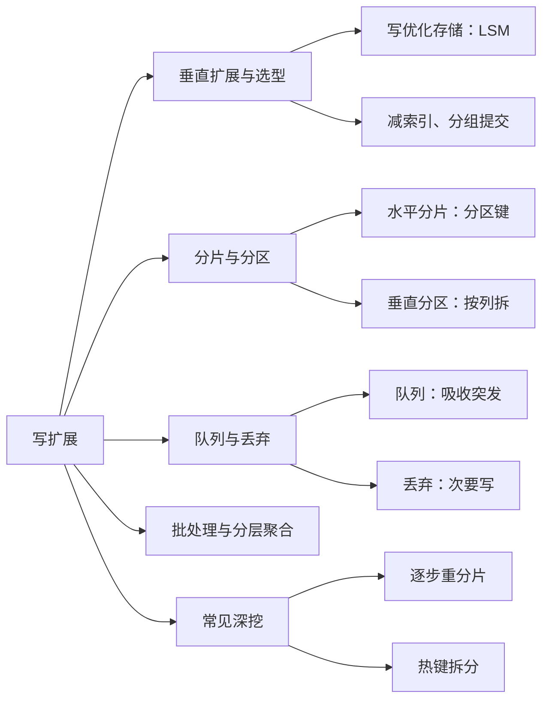

## Q
**写扩展 · 这一章的地图**｜通览

写扩展这一章要解决什么问题？有哪几块，靠哪几个直觉串起来？

## A
**一句话。** 写入在单机单库上撞到磁盘、CPU、网络的上限，办法是让每个组件扛的吞吐变小。

**关键直觉。**
- **先算账再动手：** 估出写吞吐，证明单机用尽了，再加复杂度；队列带来延迟，分区让读变复杂，批处理有丢窗口。
- **分片均匀只对键的数量成立：** 单个爆款键的流量拆不开，要拆成子键写、读时求和；前提是数据可聚合（计数、余额）。
- **队列只吸收突发，不治过载：** 稳态写入持续快过落库，队列无限增长，用户还被告知已接受；要先解决稳态吞吐。
- **先问这条写值不值：** 能被后一条覆盖的（位置上报）直接丢，每条都重要的（订单）才缓冲。

**容易漏的细节。**
- **分区键也看读路径：** 写分散了，但一个请求要跨很多分片收集数据，开销照样大；用国家当键则会倾斜。
- **取模扩容要大搬家：** 8 片翻成 16 片就有约一半的键换位置；预先切成几千个逻辑分片再映射到节点，扩容只搬槽。
- **批处理不一定有用：** 窗口内同一键很少重复时写入次数没减少；先看合并比，内存里的批宕机还会丢。
- **队列满了要有背压：** 设上限、返回 429 或 503，而不是堆到以后一起崩；异步写入要返回 202，落库用请求 ID 去重。
