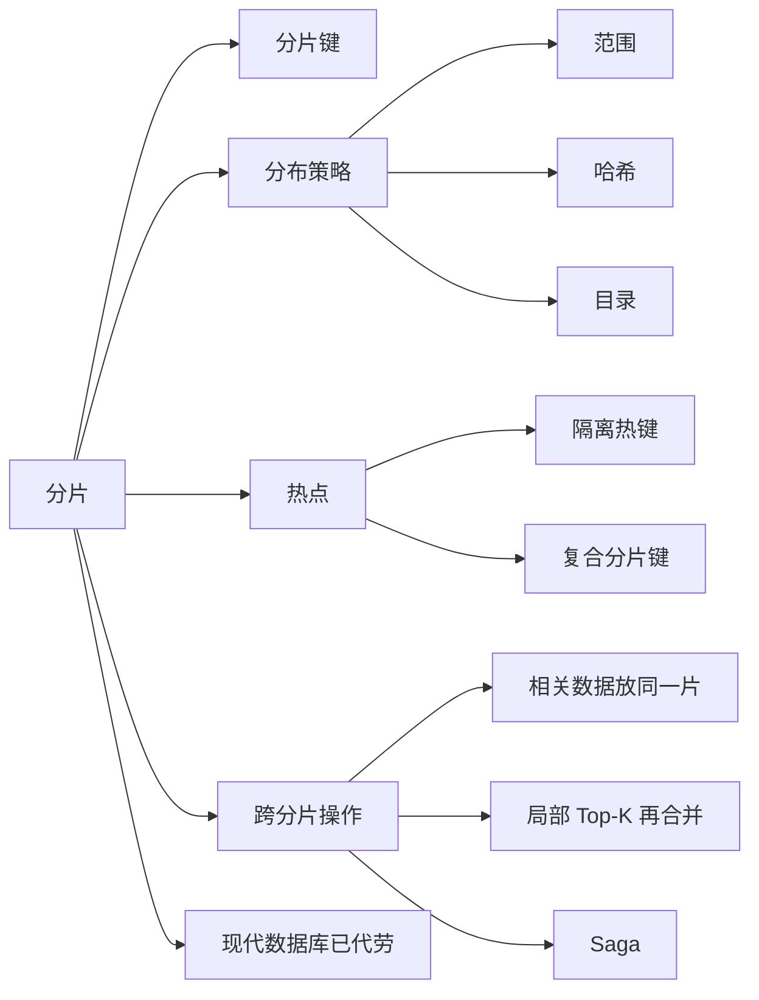

## Q
**分片 · 这一章的地图**｜通览

分片要解决什么问题？有哪几块，靠哪几个直觉串起来？

## A
**一句话。** 单个数据库的存储或吞吐撑不住时，把数据按分片键切到多台机器上，关键是选对分片键和分布策略。

**关键直觉。**
- **分片键同时决定均匀和查询落点：** 按餐厅分，商家查订单落一片，顾客查"我的订单"要扇出所有分片，得靠二级索引或再存一份按用户分的数据。
- **热点来自键本身，换哈希函数没用：** 一个键只能落在一片上，只能把它隔离到专用分片、复制读，或加时间桶拆开，代价是读要扇出。
- **跨分片操作能避开就避开：** 先靠分片键让相关数据同片，其次缓存汇总，Saga 最后；它有可见的中间态，每步还要幂等。
- **最常见的错误是过早分片：** 每秒写几十次、总共 1 TB，一台带读副本的主库就够。

**容易漏的细节。**
- **取模扩容要搬约 80%：** 4 片扩到 5 片，所以要一致性哈希，或预先切 1024 个逻辑分片再映射到机器（Redis Cluster 是 16384 个槽）。
- **深分页成倍放大：** 取全局第 1000 到 1020 条，每片都得返回前 1020 条；改用游标，每片只取 20 条。
- **目录自己是单点：** 客户端缓存映射，或默认哈希路由、只让少数特殊账号走目录。
