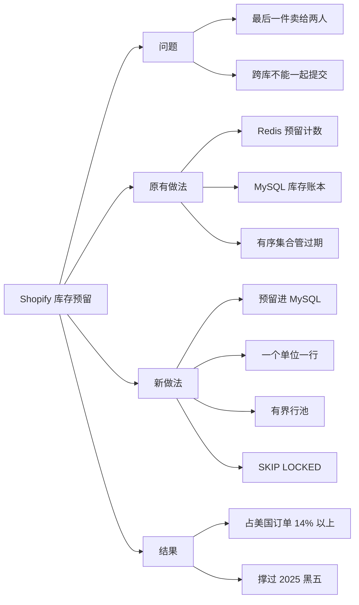

## Q
**Shopify 库存预留 · 这个案例的地图**｜通览

Shopify 库存预留的问题是什么，原来怎么做，新设计抓住了什么？

## A
**一句话。** 预留计数在 Redis、库存账本在 MySQL，两边不能一起提交；Shopify 把预留搬进 MySQL，用有界的行池加 SKIP LOCKED 化解热点。

**关键直觉。**
- **要一起提交的东西放同一个库：** 预留和扣库存进同一个事务，崩溃时就不会对不上；若偶尔不一致可补偿，Redis 计数更简单。
- **热点来自一行计数：** 一个单位一行，并发买家用 SKIP LOCKED 各抢不同的行，互不等待；分片计数器也能分散热点，但售罄判断要查所有分片，适合容忍近似的计数。
- **Redis 里过期不会自己归还库存：** TTL 删的是整个计数器，键过期只删键不执行副作用；所以要有序集合按截止时间排，后台 worker 用原子脚本移除并归还。

**容易漏的细节。**
- **SKIP LOCKED 可能只返回不足的行：** 被别的事务锁住的行会被跳过，拿不够时不能马上判定缺货，要补充或稍后重试再对账本。
- **订单比池还大会被误判缺货：** 池上限 1000 行时要 1500 件的订单会拿不够；可内联补充、分批预留，或让大订单直接对账本做条件扣减。
- **降到 READ COMMITTED 避开间隙锁：** 要求行格式的二进制日志，且只给这类加锁扫描降级。
