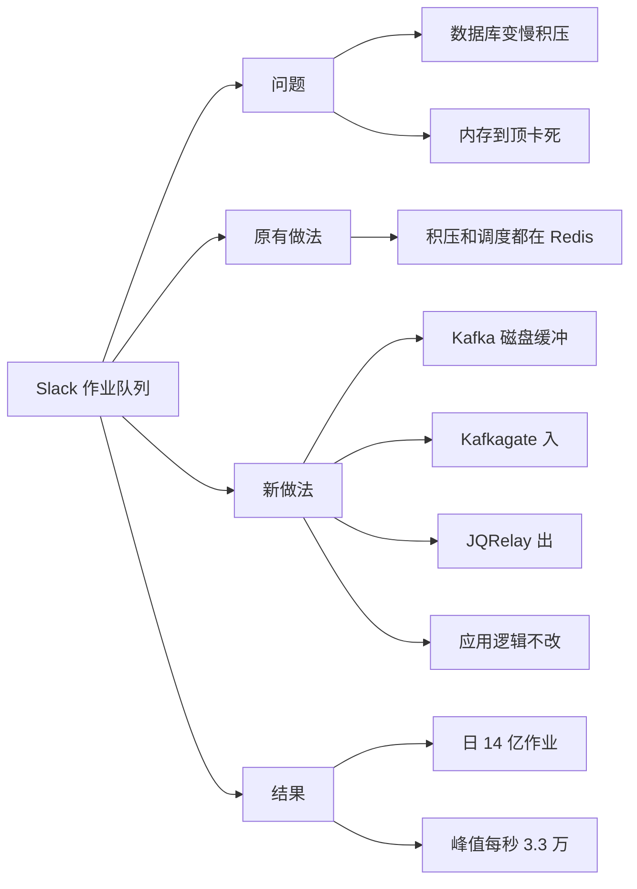

## Q
**Slack 作业队列 · 这个案例的地图**｜通览

Slack 作业队列的问题是什么，原来怎么做，新设计抓住了什么？

## A
**一句话。** 整个作业队列放在 Redis 内存里，数据库变慢时积压撑满内存，入队和出队一起卡死；Slack 在前面加 Kafka 做磁盘上的缓冲，Redis 只留短短的调度窗口。

**关键直觉。**
- **积压和调度工作空间是两件事：** 同一块内存既要吸收突发，又要做调度、去重、重试；积压搬到磁盘，受保留时间而不是内存限制，Redis 只留要排空的那一小段。
- **反压施加在日志和快速层之间：** 入队永远快，积压由日志吸收，调节中继速率；该盯的指标是消费滞后的趋势，持续增长说明排空慢于流入。
- **内存缓冲要为最坏积压买单：** 积压速率是流入减消化，例如每秒多 1.3 万个、持续 10 分钟，约 780 万个作业，按每个 1 KB 约 7.8 GB；磁盘上只是日志变长。
- **持久性按作业价值分级：** 多数作业选最低延迟，计费这类要等所有同步副本确认，并做成幂等。

**容易漏的细节。**
- **Redis 满了不能靠淘汰策略救：** 默认拒绝增加内存的写，入队失败；LRU 之类会悄悄丢作业，比报错更糟。
- **这条链是至少一次：** 中继写入 Redis 后、提交偏移前崩溃，会重复；Kafkagate 只等 leader 确认，leader 在复制前宕机会丢。
