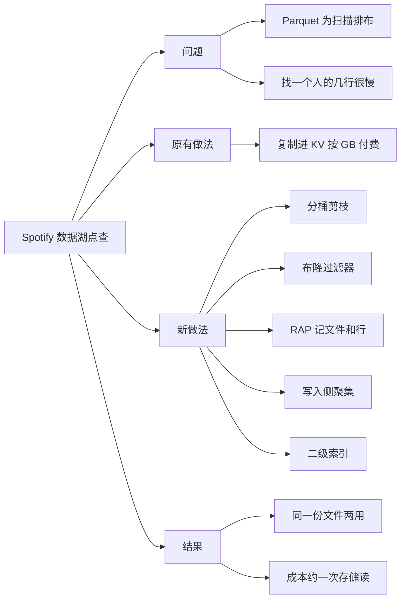

## Q
**Spotify 数据湖点查 · 这个案例的地图**｜通览

Spotify 数据湖点查的问题是什么，常见补救是什么，新设计抓住了什么？

## A
**一句话。** EB 级数据湖擅长扫描，查某一个用户的数据却很慢；Spotify 建了叫 RAP 的外部索引，加上写入侧聚集，不复制数据就能点查。

**关键直觉。**
- **先排除文件，再定位行，再缩小要读的量：** 分桶和布隆过滤器只能说"可能在哪些文件"，RAP 才精确到文件内的行；写入时让同一用户的数据挨在一起，读的量才真正变小。
- **剪枝之后，瓶颈是文件内部的依赖读：** 73 万个文件分桶后剩 365 个，其中 20 个真有这个用户的数据，其余按 1% 误报再多开约 3.5 个；这时文件数已不是问题。
- **三条路按延迟目标选：** QPS 约 50、可接受 200 ms 用外部索引；QPS 约 20 万、p99 低于 10 ms，只把热子集复制进 KV，冷的长尾仍走索引。

**容易漏的细节。**
- **按列统计只对排序键有效：** Parquet 每个行组记最小最大值，乱序写入时几乎每组都覆盖全域，什么也剪不掉。
- **布隆过滤器只会误报，不会漏报：** 每个键约 10 比特，误报约 1%；只回答"在不在"，不回答"在哪"。
- **湖表格式也做文件级剪枝：** Iceberg 等只精确到文件，不到行，所以文件内的依赖读仍在。
