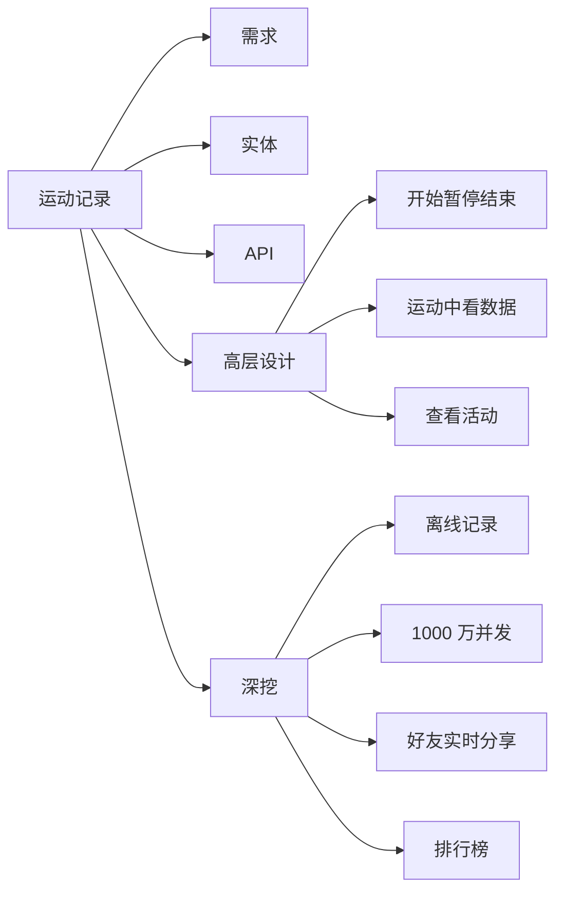

## Q
**Strava 运动记录 · 这道题的地图**｜通览

Strava 这道题按什么顺序讲？每一步的要点是什么？

## A
**一句话。** 难点是野外没信号、又要撑 1000 万并发；关键是让手机当主角，数据先记在本地，结束或联网时一次上传。

**先定下的约束。**
- **范围外：** 好友管理、认证授权、评论点赞、隐私合规；只做跑步和骑行。
- **非功能需求：** 可用性远高于一致性；无网络也能用；本地统计准确及时；1000 万并发活动。
- **核心实体：** User、Activity、Route（可做 Activity 的字段）、Friend。
- **API：** `POST /activities`、`PATCH /activities/:id`（改状态）、`POST /activities/:id/routes`、`GET /activities`、`GET /activities/:id`。

**关键直觉。**
- **两条非功能需求直接指向本地优先：** 无网络可用加本地统计准确，数据只能先在手机上；每 3 秒传一个点时 1000 万并发是约 333 万次写/秒，一次上传一个活动则 1 亿活动/天平均约 1,157 次/秒。
- **存事实，不存结果：** 记状态加时间戳的日志，用时是各段运行区间之和，暂停不计；手机用单调时钟。
- **ID 由客户端生成：** 离线也能开始，上传按 ID 覆盖写，重发不会重复。
- **好友实时看用轮询：** 几秒延迟可接受、读多可缓存 1–2 秒，不必上 WebSocket。

**容易漏的细节。**
- **ZINCRBY 不幂等：** 重试会重复累计里程，要按活动 ID 去重，并定期用主库对账。
