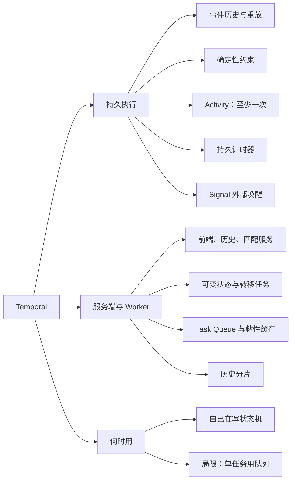

## Q
**Temporal · 这一章的地图**｜通览

Temporal 怎么让多步骤流程扛住崩溃和长等待？机制怎么串起来，何时该用？

## A
**一句话。** 多步骤流程要扛住崩溃、重试和长时间等待；Temporal 记录每步结果，崩溃后重放代码恢复，让流程像顺序代码一样写。

**关键直觉。**
- **正确性来自历史，其余都是优化：** 缓存、粘性、可变状态只省重放的成本；缓存了状态的 Worker 崩溃，换一台用历史重放即可，多花一次延迟。
- **重放保护不了“做了但没来得及记录”：** Activity 做完外部操作、上报前崩溃，会被重试，所以只能保证至少一次，外部操作靠幂等键关上这条缝。
- **确定性的规则只有一条：** 凡是每次执行可能得到不同结果的来源，要么走 SDK 提供的确定性接口，要么放进 Activity 让结果被记录。
- **扩容要按瓶颈：** 延迟高但 Worker 空闲、队列不积压时，该扩的是 History 实例和数据库写入，不是 Worker。

**容易漏的细节。**
- **历史有上限：** 51,200 个事件或 50 MB；永远在跑的 Workflow 要用 continue-as-new 换新执行。
- **改在途 Workflow 的代码会触发非确定性错误：** 历史里的事件和新代码对不上，要用补丁分支、按版本路由 Worker，或在 CI 里重放生产历史。
- **信号只能发给运行中的执行：** 没启动用 Signal-With-Start，已结束会报错，重复信号要自己按业务事件 ID 去重。
