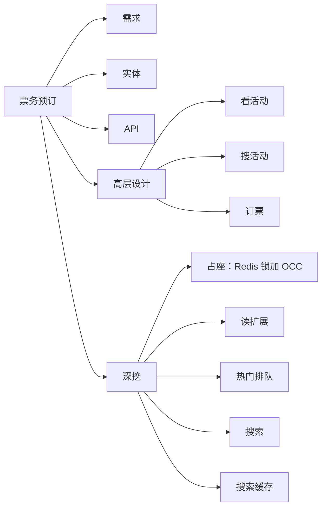

## Q
**票务预订（Ticketmaster） · 这道题的地图**｜通览

票务预订这道题按什么顺序讲？每一步的要点是什么？

## A
**一句话。** 浏览搜索要高可用，订票要强一致不重复卖；难点是订票时先占座再付款，以及热门开售时的读流量与排队。

**先定下的约束。**
- **范围外：** 看已订的票、管理员加活动、动态定价。
- **非功能需求：** 浏览搜索偏可用性，订票偏一致性；读写比约 100:1；单个活动千万人同时访问；搜索低于 500ms。
- **核心实体：** Event、User、Performer、Venue、Ticket（建活动时每座一张）、Booking（一次买多张归一单）。
- **API：** `GET /events/:eventId`、`GET /events/search`、`POST /bookings/:eventId`。

**关键直觉。**
- **一个系统里两种相反的一致性：** 活动描述稍旧无伤大雅，同一座位卖两次会让两人带着票到场，所以按功能分别取舍。
- **Redis 锁管体验，数据库管正确：** 锁过期后两人都可能付款，数据库事务只放过一人，另一人自动退款；Redis 挂了只是填完支付才失败，不会双订。
- **最热场次要换业务角度：** 座位瞬间被抢空，推送座位变化也跟不上，改成先排队再看选座页，按售出速度放人。
- **支付回调以对方为准：** 回调会乱序或丢失，要状态机、以 bookingId 做幂等，再定期对账。

**容易漏的细节。**
- **释放锁要比较持有者：** 直接 DEL 会删掉别人的锁，要用 Lua 先比后删。
- **站票用计数器：** 条件更新扣减，但单行成了热点。
