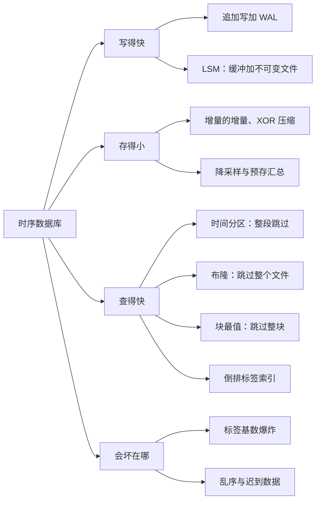

## Q
**时序数据库 · 这一章的地图**｜通览

时序库靠哪些积木扛住高吞吐的监控数据？这些积木各依赖什么假设，何时失效？

## A
**一句话。** 监控这类每秒数万点的只追加、按时间查询的负载，通用数据库扛不住；时序库靠追加写、压缩、按时间分区这几件积木和几条数据假设拿到高吞吐。

**关键直觉。**
- **每件积木靠一条数据假设换速度：** 时间递增、间隔规律、相邻值相近、标签取值少；假设一破，压缩、分区和索引同时失效，比通用库还差。
- **三种裁剪各管一类条件：** 时间范围靠分区，“是不是这个序列”靠布隆过滤器，“值超过阈值”靠块的最大最小值；找单个序列用不上块元数据，按值过滤用不上布隆过滤器。
- **LSM 用读和空间换写吞吐：** 读要翻多个文件、压缩要重写；写多读少才划算，每秒几百次随机点读用 B 树更合适。
- **物理布局对齐生命周期：** 按天分区后，90 天前的数据是删整个分区，与数据量无关，而大表 `DELETE` 要逐行标记再靠回收。

**容易漏的细节。**
- **标签还是字段：** user_id、request_id 这类取值无限的维度只能放字段，当标签会让序列数暴涨、内存索引撑爆。
- **降采样会让汇总过期：** 迟到数据落进已算好的窗口，要重算或接受最终一致。
- **别看到时间戳就选时序库：** 先问是否追加、规律、低基数，再问通用库是否真撑不住。
