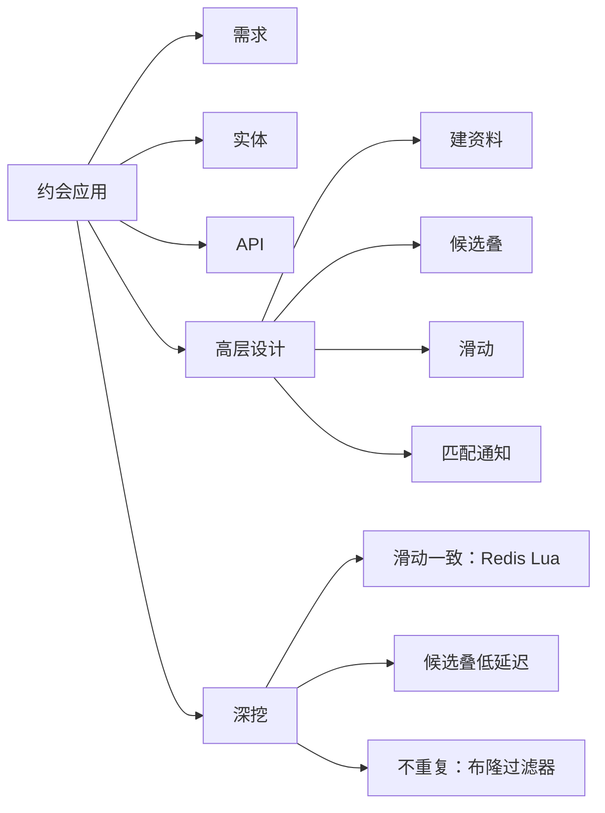

## Q
**约会应用（Tinder） · 这道题的地图**｜通览

约会应用这道题按什么顺序讲？每一步的要点是什么？

## A
**一句话。** 难点有三：互相右滑的并发要当场判成匹配，候选叠要在 300ms 内出来，滑过的人不能再出现。

**先定下的约束。**
- **范围外：** 传照片、私信、付费功能、防假资料和监控。
- **非功能需求：** 滑动强一致；2000 万日活、人均约 100 次滑动，即 20 亿次/天，平均约 2.3 万次/秒、约 200GB/天；候选叠低于 300ms；不重复展示。
- **核心实体：** User、Swipe、Match。
- **API：** `POST /profile`、`GET /feed`（位置由客户端传）、`POST /swipe/{userId}`。

**关键直觉。**
- **竞态来自先检查后写入：** 两人同时检查都没看到对方，匹配就永久丢了。按 swiping_user_id 分区时两个方向必在不同分区，所以要让两方向同分区，或交给 Redis 脚本原子完成。
- **缓存管首屏，索引管刷得多：** 预计算叠让一打开就能滑，快刷完时由地理索引补算；缓存会过期，要设 TTL 并只预热活跃用户。
- **宁可少展示，不能重复展示：** 布隆过滤器只会误报、不会漏报，正合需求。

**容易漏的细节。**
- **Redis 未命中不能判为没匹配：** 去重后对方不会再出现，漏掉就没有第二次机会；要回退查 Cassandra。
- **推送是尽力而为：** 先存匹配再推送，用户打开应用时主动拉取。
