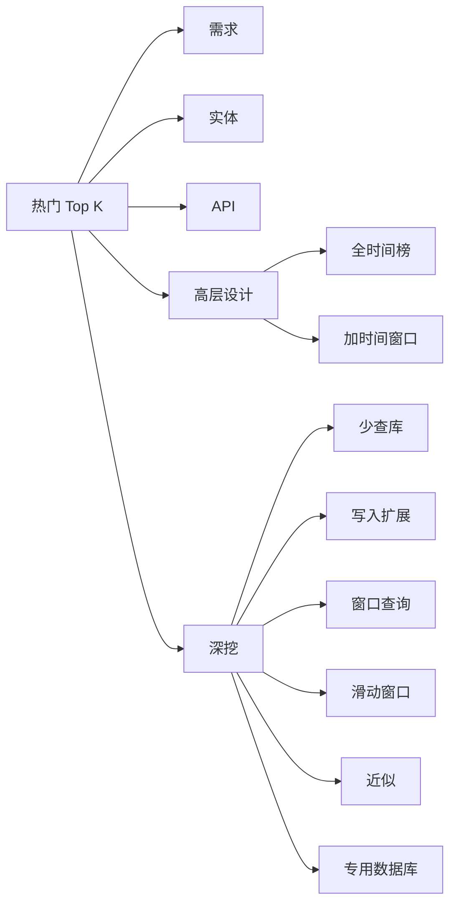

## Q
**YouTube 热门 Top K · 这道题的地图**｜通览

YouTube 热门 Top K 这道题按什么顺序讲？每一步的要点是什么？

## A
**一句话。** 流式计数加取前 K，算法简单，难点在海量写入、窗口求和的大扫描和几十毫秒的读延迟；答案是按视频分片、批量聚合写入、预计算榜单放缓存。

**先定下的约束。**
- **范围外：** 任意起止时间的窗口；窗口只给全部、1 小时、1 天、1 月，K 最多 1000。
- **非功能需求：** 播放到入账最多晚 1 分钟；结果精确；查询几十毫秒；约 700 亿次播放/天。
- **核心实体：** Video、View、Time Window。
- **API：** 只有 `GET /views/top-k?window=&k=`；播放事件假设已在按视频 ID 分区的 Kafka 里。

**关键直觉。**
- **几十毫秒的读逼出预计算：** 现算不可能，榜单允许稍旧，所以定时算好放进缓存；用滚动窗口（整点对齐），一个窗口内结果不变，才能整段预算。
- **分片键必须是视频 ID：** 按事件散列时 X 在三个分片各 40 次、共 120 次，却被各分片前 1 名挤掉；同一视频计数完整落一片，各片前 K 才含全局前 K。
- **播放可加，所以先局部再合并：** Flink 一分钟窗口先求和再写库，热点视频也只多出小计，不多出事件。

**容易漏的细节。**
- **重放的写入要幂等：** 写窗口起点加绝对值，不要 `views = views + x`，否则回放会重复累加。
- **近似只在分数线附近出错：** 以每小时约 29 亿次播放算，误差上界约 2917 次；第 1000 与 1001 名只差几百次时顺序不可信。
