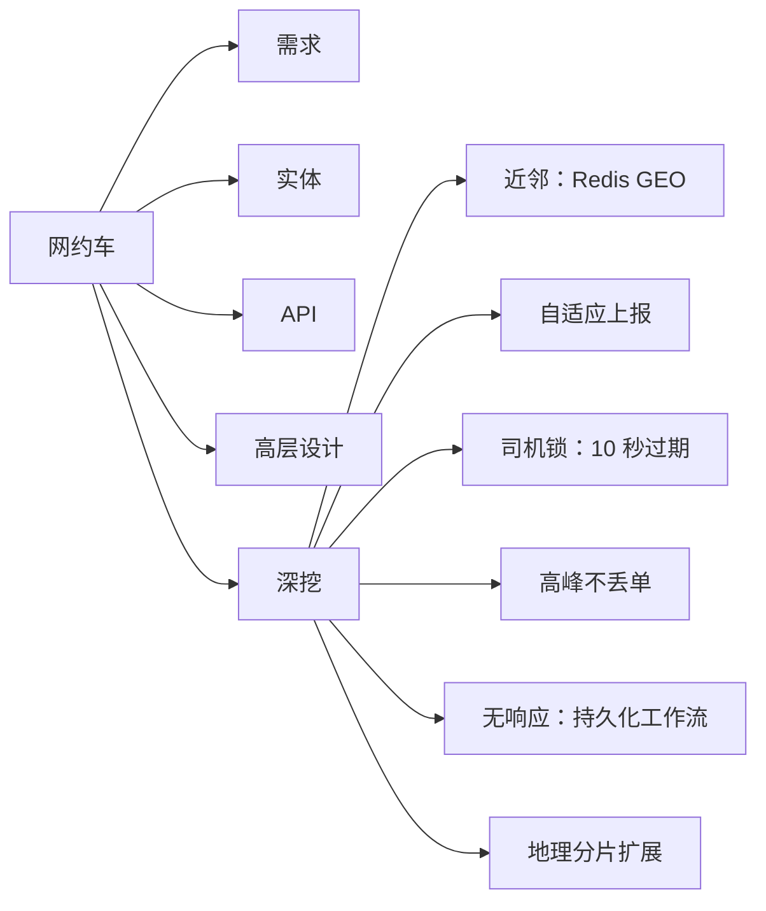

## Q
**网约车 · 这道题的地图**｜通览

网约车这道题按什么顺序讲？每一步的要点是什么？

## A
**一句话。** 难在两点：每秒约 200 万次位置更新要能查近邻，一个司机同一时刻只能收到一个订单。答案是内存地理存储、带过期时间的锁、队列加持久化工作流。

**先定下的约束。**
- **范围外：** 乘客司机互评、预约叫车、车型分类。
- **非功能需求：** 一分钟内匹配成功或明确失败；匹配强一致；高峰同一地点约 10 万个请求。
- **核心实体：** Rider、Driver、Fare、Ride、Location。
- **API：** `POST /fare`、`POST /rides`（只带 fareId）、`POST /drivers/location`、`PATCH /rides/:rideId`；价格从库里读，不收客户端的。

**关键直觉。**
- **位置只要最新值：** 1000 万司机每 5 秒上报是约 200 万次写/秒，覆盖写（GEOADD）不用批处理；按地理区域分片，近邻搜索只查一个实例，按司机 ID 哈希则要查全部。
- **锁只保证大多数时候互斥：** 正确性靠写入时的条件检查，锁值带 rideId，或 `WHERE status='requested'` 条件更新。
- **至少一次投递要求幂等：** 匹配成功才提交偏移量不丢单，但重复消费会把同一单发给两位司机；订单上记当前报价，或以订单 ID 做工作流 ID。

**容易漏的细节。**
- **geohash 有边界：** 相距一米也可能隔着格子，要查中心加相邻共 9 格，再按真实距离过滤。
