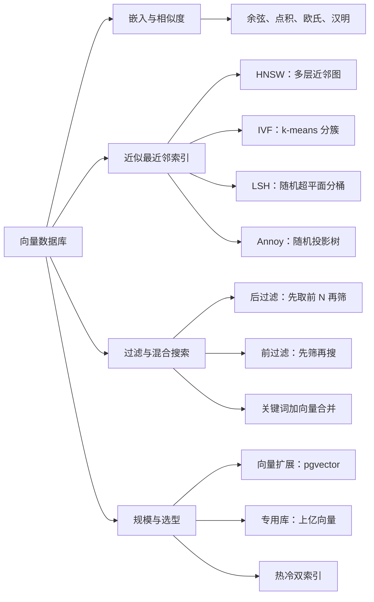

## Q
**向量数据库 · 这一章的地图**｜通览

向量数据库怎么按语义找相似？索引、过滤、扩展和选型之间有哪些取舍？

## A
**一句话。** 按语义而不是精确值找相似的东西：把内容变成一串数字（向量），用近似最近邻索引快速找出最相近的一批。

**关键直觉。**
- **近似是用召回换延迟：** 不保证找全最近的，约 95% 召回通常够；100% 就是精确搜索，成本极高。
- **索引的差别在内存、建图和更新：** HNSW 召回高但内存约翻倍、插入贵；IVF 省内存、建得快但召回较低；Annoy 索引不可变，适合批量更新的静态库。
- **过滤要看选择性：** 条件命中九成就后过滤，命中千分之一就前过滤，否则要取一万个候选才凑得够。
- **向量库是索引，不是真相来源：** 正文、权限、版本放主库，向量库只返回 ID；几百万向量用 pgvector 就够，上亿才考虑专用库。

**容易漏的细节。**
- **换嵌入模型不能原地替换：** 新旧向量不在同一空间，要建新索引、双写、验证后切换，并记下每个向量的模型版本。
- **新内容涌入要热冷双索引：** 每秒几千条插入对 HNSW 太贵，先进小的热索引，再定期合并重建。
- **分片查询被最慢的一片拖住：** 分片越多尾延迟越高，要用对冲请求和超时。
