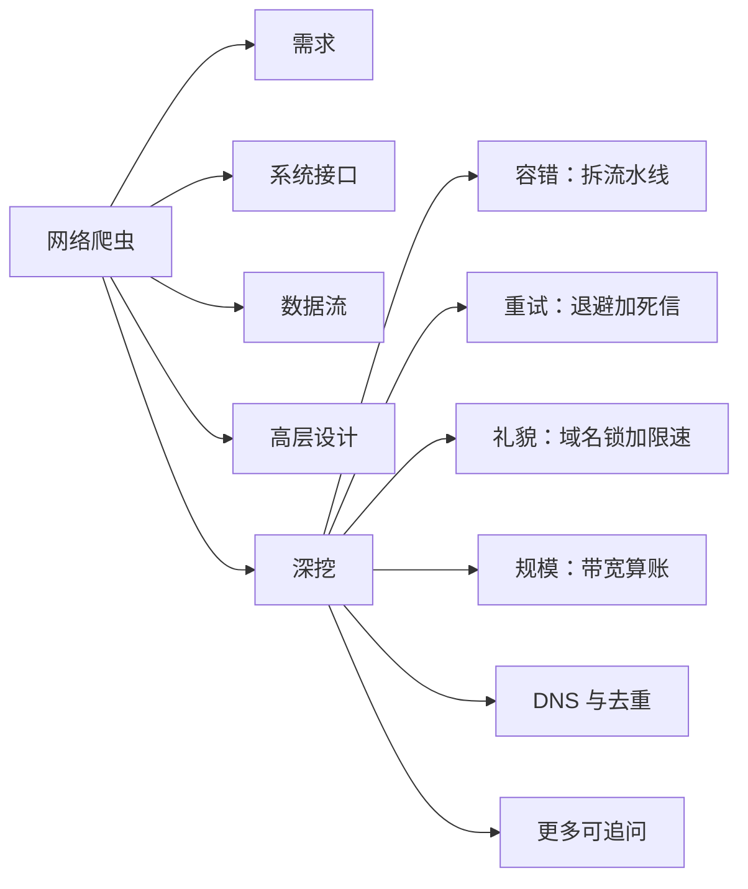

## Q
**网络爬虫 · 这道题的地图**｜通览

网络爬虫这道题按什么顺序讲？每一步的要点是什么？

## A
**一句话。** 难在 100 亿页要在 5 天内爬完，又不能压垮目标站点、不能丢进度。答案是把爬虫拆成流水线阶段，队列加元数据库记状态，再按域名做礼貌控制。

**先定下的约束。**
- **范围外：** 训练处理、非文本、动态渲染、登录页；只能覆盖绝大多数网页，不是全部。
- **非功能需求：** 容错；礼貌；5 天内爬完 100 亿页；每页按 2MB 估带宽。
- **接口与数据：** 种子 URL 进、页面文本出；元数据库存 URL 状态，域名表存上次爬取时间，正文放对象存储。

**关键直觉。**
- **最易失败的一步最贵：** 拉网页常失败，所以拉取和提取分两级，只重试出错的一级；队列只放 ID，不放 HTML。
- **成功落盘才确认：** 消息留在队列到存好为止，崩溃后别的实例接着做。
- **礼貌限的是单域名，不是总吞吐：** 每域名每秒 1 个请求，但爬虫同时面对数百万个域名。
- **瓶颈是带宽：** 单机 200 Gbps、利用率 30%、每页 2MB 时，单机爬完约 30.9 天，8 台约 3.9 天；台数与利用率、期限近似反比。

**容易漏的细节。**
- **礼貌等待别当成失败：** SQS 每次取出都给接收次数加一，同域名排队的 URL 几分钟内超过 5 次就进死信队列，网页就丢了。
- **陷阱的危险是宽度：** 每页链出 10 个新 URL 时第 15 层有 10^15 个，要再给每个域名设页数预算。
