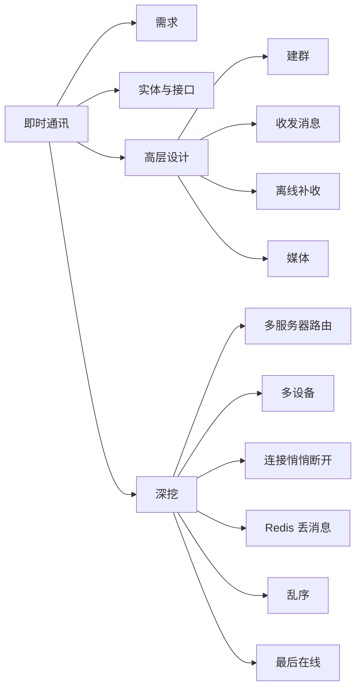

## Q
**即时通讯 · 这道题的地图**｜通览

即时通讯这道题按什么顺序讲？每一步的要点是什么？

## A
**一句话。** 难点是海量长连接分散在许多服务器上，消息要找到收件人所在的那台；答案是先写库保证送达，再用 Redis Pub/Sub 尽力实时推送。

**先定下的约束。**
- **非功能需求：** 在线投递低于 500ms；保证送达；约 10 亿用户、2 亿同时在线；群上限 100 人，离线 30 天内补收。
- **核心实体：** User、Chat、Message、Client（一人多设备）。
- **API：** WebSocket 命令 `createChat`、`sendMessage`、`createAttachment`，服务器推 `newMessage`，客户端必须 ack。

**关键直觉。**
- **先写库，再尽力推：** Pub/Sub 至多一次，持久靠消息表和收件箱，收到 ack 才删；丢了推送，用户上线时从收件箱补。
- **难点是连接状态放哪：** 每用户一个 Kafka 主题太重（每个约 50KB，10 亿用户 50TB 以上），一致性哈希要服务器两两互联；Pub/Sub 让服务器为连上的用户订阅 userId 频道，状态就在订阅里。
- **重复无害：** 客户端生成消息 ID 做上行幂等，下行至少一次、客户端按 ID 去重，重复到达也要回 ack。

**容易漏的细节。**
- **Cluster 里的经典 Pub/Sub 是广播：** 加节点反而放大总线流量；要用分片 Pub/Sub 或按 userId 哈希到独立实例。
- **服务器时钟有偏差：** 按接收时间戳排序可能显示成答在问前；要因果保证就按聊天分配序号。
