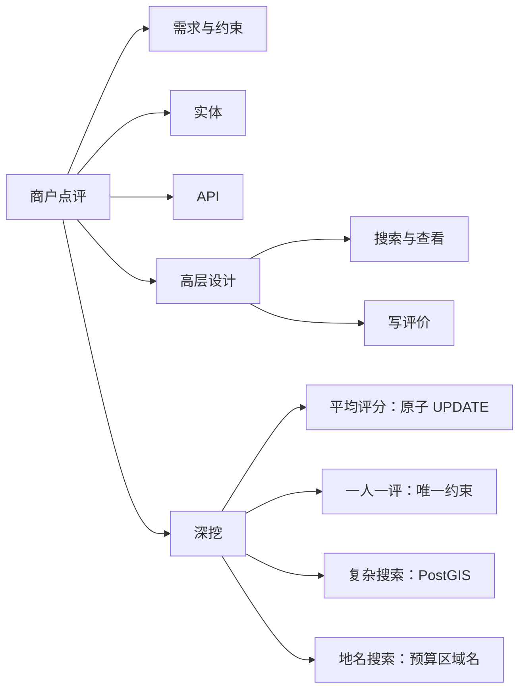

## Q
**商户点评 · 这道题的地图**｜通览

商户点评这道题按什么顺序讲？每一步的要点是什么？

## A
**一句话。** 数据量小、读远多于写，难点不在规模，而在平均评分怎样实时又正确、一人一评怎样保证、位置名称类别怎样一起搜。答案是用最简单的方案：同事务原子更新、数据库唯一约束、Postgres 扩展。

**先定下的约束。**
- **范围外：** 管理员增删改商户、地图、个性化推荐。
- **非功能需求：** 搜索低于 500ms；高可用、最终一致即可；1 亿日活、1000 万商户；每人每商户只能一条评价。
- **核心实体：** Business、User、Review。
- **API：** `GET /businesses?query&location&category&page`、`GET /businesses/:id`（评价可单独分页）、`POST /businesses/:id/reviews`。

**关键直觉。**
- **读 QPS 才是瓶颈，存储不是：** 1000 万商户每家 100 条评价、每条 1KB 约 1TB，一台库放得下，写约 11.6 次/秒不需要队列；缓存加读副本扛读，分片换不来收益。
- **约束越靠近存储越稳：** 应用层先查再写会被别的服务绕过，也有并发竞态；唯一约束由数据库保证。分片的话分片键要含商户 ID，约束才在同一分片内。
- **存评分总和，不存平均：** 插评价和累加总和放在同一事务，一条原子 UPDATE，热点行也不会丢更新；乐观锁只适合冲突少的写入。
- **昂贵又少变的计算前移：** 街区多边形在商户创建时就算好区域名，查询只做词项匹配。

**容易漏的细节。**
- **度数方框不是正方形：** 纬度 40.76° 处 1 度经度只有约 84.4km，要换算，再用球面距离二次过滤。
