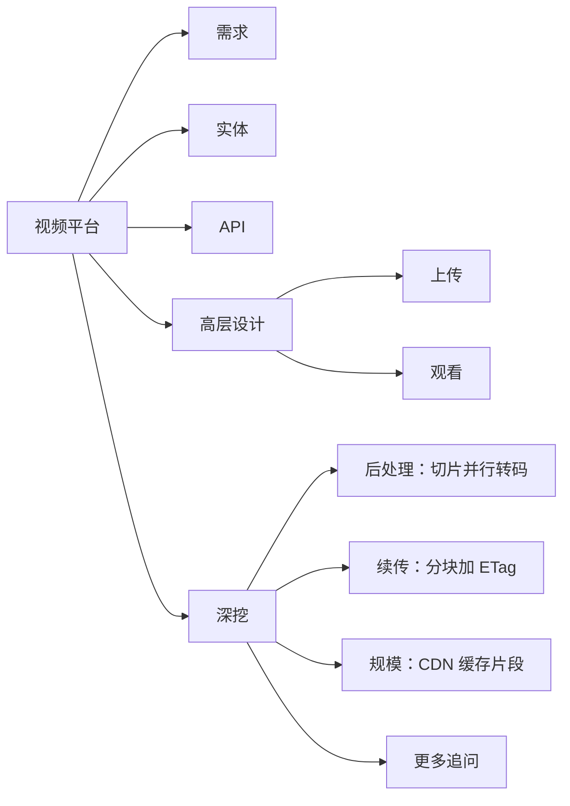

## Q
**视频平台 · 这道题的地图**｜通览

视频平台这道题按什么顺序讲？每一步的要点是什么？

## A
**一句话。** 功能只有上传和观看，难在视频又大又要适配各种网速：字节绕开应用服务器直传对象存储并可续传，处理成多格式的小片段，再用自适应码率和 CDN 播放。

**先定下的约束。**
- **范围外：** 搜索、评论、推荐、频道、订阅、违规检测。
- **非功能需求：** 可用性优先于一致性；支持几十 GB 的大视频；网差也低延迟播放；每天约 100 万上传、1 亿观看；可续传。
- **核心实体：** User、Video、VideoMetadata。
- **API：** `POST /presigned_url`（只传元数据，换回预签名地址）、`GET /videos/{id}`（元数据，含清单地址）。

**关键直觉。**
- **瓶颈是字节，不是请求数：** 1 亿次观看/天平均才约 1157 次/秒；按每次 5 分钟、2.5Mbps 算，出口约 9.4PB/天，平均约 870Gbps，单个数据中心放不下，只能靠 CDN。
- **存成多格式乘小片段才能自适应：** 整片下载 10GB 在 100Mbps 下要 13 分钟以上；清单加几秒的小片段走普通 HTTP，CDN 可缓存，播放器按网速换档。
- **转码任务要幂等：** 切点对齐关键帧，输出路径由视频 ID、片段序号、格式决定，失败只重试出错的片段。

**容易漏的细节。**
- **S3 分片上限 10,000 片：** 50GB 按 5MB 切正好顶格，块大小至少文件大小除以 10,000；放弃的分片上传仍占存储计费，要设生命周期规则清理。
- **观看计数是热点行：** 先缓冲再批量写，或拆成分片计数器；展示可估算，涉及结算要精确。
