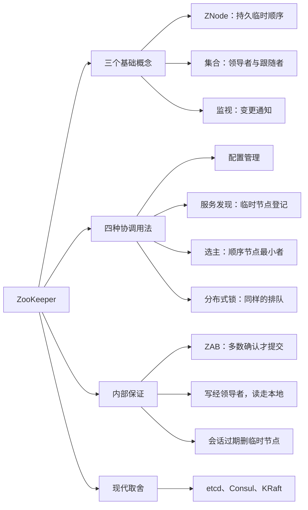

## Q
**ZooKeeper · 这一章的地图**｜通览

ZooKeeper 靠什么提供一致的协调？四类用法、内部保证和现代取舍怎么串起来？

## A
**一句话。** 多台服务器要共享一份一致的真相来发现服务、共享配置、检测故障、选主，ZooKeeper 提供一个同步的元数据树，变更时通知关心的人。

**关键直觉。**
- **三样原语拼出所有用法：** 临时节点把“活着”变成数据，顺序节点把“谁先到”变成数据，监视把“变了”推出去。
- **一致性靠多数，所以偶数台没有好处：** 4 台和 3 台都只容忍 1 台故障，对半劈开时两边都没有多数、整体不可写；它在分区里选一致性，不选可用性。
- **它是协调服务，不是数据库：** 数据小、节点数千量级，写要多数落盘；5000 万用户的路由不放进去，只登记 1000 台服务器，用户到服务器靠一致性哈希算。
- **能用平台自带的就不引入它：** Kubernetes 自带 etcd，Kafka 新版用 KRaft；HBase、ClickHouse 这类系统本身依赖它才非用不可。

**容易漏的细节。**
- **跟随者读可能是旧值：** 读不经领导者；要最新就先 `sync`，保证的是顺序一致，不是线性一致读。
- **监视是一次性的，且只说“变了”不说变了几次：** 通知后要重新设监视并重读全量状态；选主只监视前一个节点，避免惊群。
- **锁的持有者可能已过期：** GC 停顿后会话失效、别人拿了锁；资源端要校验单调递增的围栏令牌。
