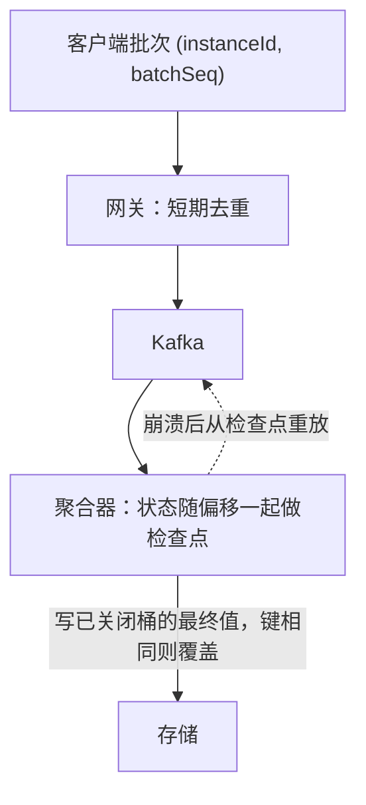

## Q
**指标聚合系统 · 把累加变成覆盖**｜必会 · 出自：指标聚合系统 › 深入 2

计数的“加 1”不是幂等的，聚合器重放或客户端重试会让计数翻倍。设计上怎么避免？

## A
**要点。** 两层。批次 `(instanceId, batchSeq)` 在网关短期去重；聚合器状态随 Kafka 偏移一起做检查点，崩溃后从检查点重放。

**关键。** 写入的是“已关闭桶的最终值”，键相同则覆盖，不是“+1”。重放写出同一个值，计数不会翻倍。这是把非幂等累加转换成幂等覆盖。

