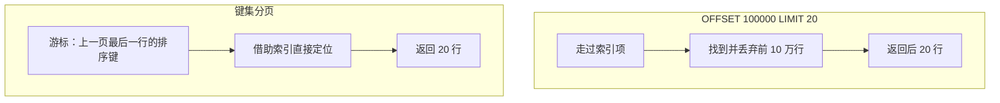

## Q
**API 设计 · 偏移分页为什么越翻越慢**｜拓展 · 加分
为什么 `OFFSET 100000 LIMIT 20` 在大表上很慢？游标分页在数据库里怎么写才又稳又快？

## A
- **偏移的成本：** 数据库必须先找到并丢弃前 10 万行，才能返回后 20 行，耗时随偏移线性增长，即使有索引也要走过那些索引项。
- **键集分页（keyset / seek）：** 游标里编码上一页最后一行的排序键，下一页用 `WHERE (created_at, id) < (?, ?) ORDER BY created_at DESC, id DESC LIMIT 20`，借助索引直接定位，与翻到第几页无关。

- **必须有唯一的决胜键：** 只用 `created_at` 排序，同一时刻的多行会被漏掉或重复；加上主键 `id` 作为第二排序键，保证全序。
- **游标要不透明：** 对客户端是编码后的字符串，服务端可以改内部格式而不破坏客户端。
- **限制：** 排序方式必须与索引匹配；不能跳到任意页；总数需要另外计算。
