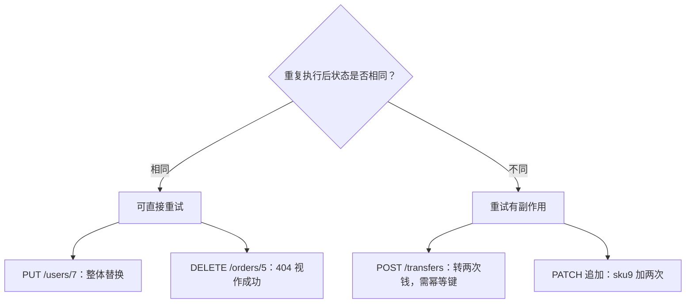

## Q
**API 设计 · 哪些请求能直接重试**｜考点 · 必会
网关对超时请求自动重试一次。判断下面几个请求重试后的后果：`PUT /users/7 {name:"A"}`、`POST /transfers`、`PATCH /carts/3 {"items":{"$append":"sku9"}}`、`DELETE /orders/5`。

## A
- **`PUT`：** 整体替换，重复结果相同，安全。
- **`POST /transfers`：** 最危险，创建新转账，重试会转两次钱。需幂等键，或把转账 ID 由客户端先生成再 PUT。
- **`PATCH` 追加：** 语义是"追加一项"，重试会把 sku9 加两次；PATCH 是否幂等取决于语义，改成"设置整个列表"或带版本号才安全。
- **`DELETE`：** 幂等，第二次可能返回 404，但状态一样；客户端要把 404 视作成功。

- **关键判断：** 不看方法名，看"重复执行后状态是否相同"。
