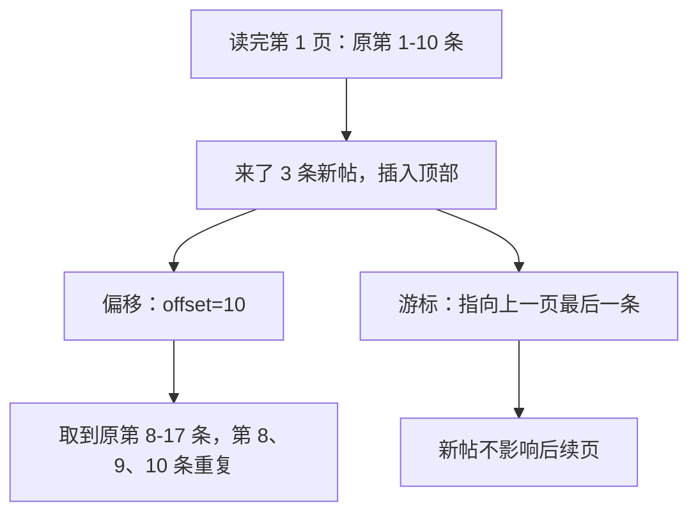

## Q
**API 设计 · 翻页选型**｜考点 · 必会
为这两个场景各选分页方式：A) 管理后台的用户表，要能直接跳到第 12 页，数据很少变；B) 信息流，每秒有新帖子进来，只向下滑。并解释 B 用偏移分页会出什么错。

## A
- **A 用偏移：** 页号跳转是偏移的强项，数据稳定，没有错位问题。
- **B 用游标：** 只向下滑，游标指向上一页最后一条，新帖子插入顶部不影响后续页。
- **偏移在 B 的失败：** 用户读完第 1 页（第 1-10 条）时来了 3 条新帖，第 2 页 `offset=10` 实际取到的是原来的第 8-17 条，原来的第 8、9、10 条再次出现，即重复。若是删除，则会漏掉记录。

- **代价对比：** 游标不能跳页、实现更复杂；偏移在大数据集上还要扫描并丢弃前面的行（偏移越大越慢）。
