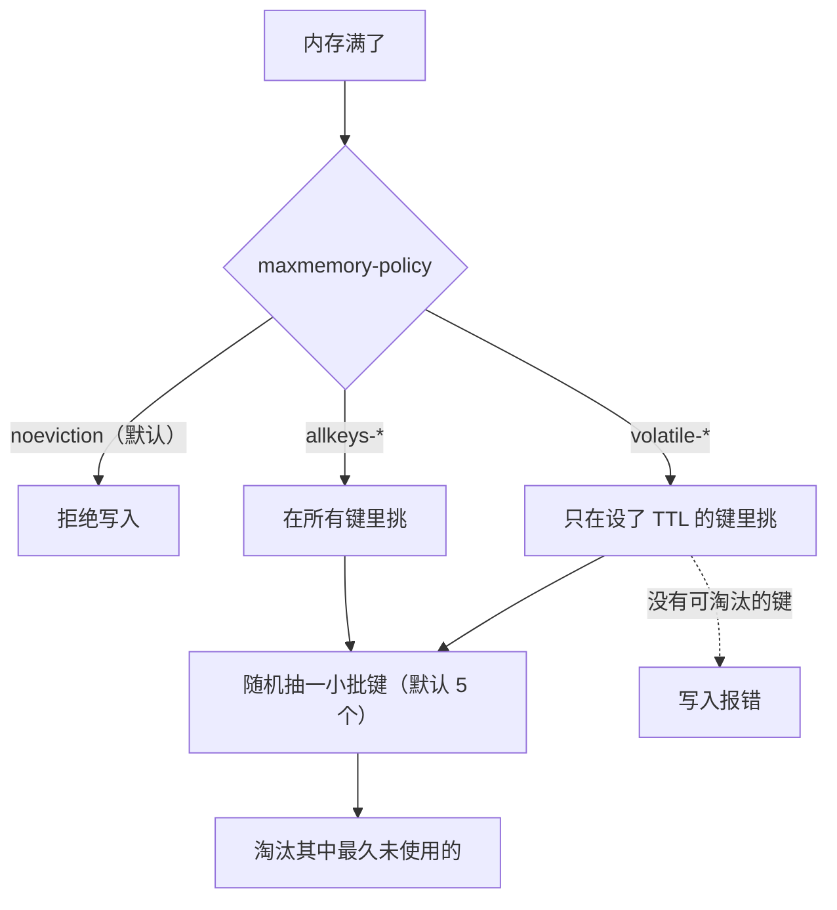

## Q
**缓存 · Redis 的淘汰是怎么做的**｜拓展 · 加分
Redis 的 LRU 是真的严格 LRU 吗？`maxmemory-policy` 里 allkeys 和 volatile 前缀是什么意思？

## A
- **近似算法：** Redis 不维护全局的严格 LRU 链表（开销大），而是在内存满时随机抽取一小批键（默认采样数是 5，可调），淘汰其中最久未使用的。样本越大越接近真 LRU，开销越高。LFU 同理，用一个很小的概率计数器近似，并带衰减。
- **前缀含义：** `allkeys-*` 在所有键里挑；`volatile-*` 只在设了 TTL 的键里挑，没设 TTL 的键永不被淘汰。把 Redis 当缓存通常选 `allkeys-lru` 或 `allkeys-lfu`；用 `volatile-*` 时若没有可淘汰的键，写入会报错。
- **`noeviction`：** 默认策略，内存满了拒绝写入，适合把 Redis 当存储而不是缓存。
- **面试说法：** "LRU 加 TTL"够用；被追问时能说出它是近似的、以及 allkeys 与 volatile 的区别，是加分。

