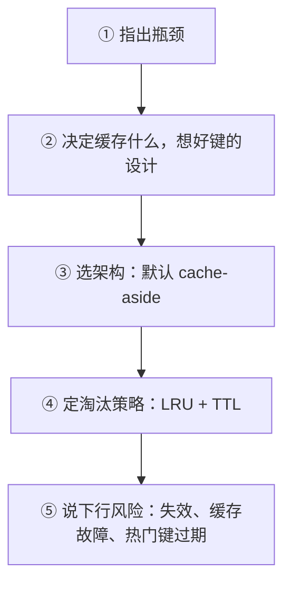

## Q
**缓存 · 面试里怎么引入缓存（五步）**｜摘要 · 必会
想好要缓存后，按什么顺序讲清楚缓存设计？每一步的示范说法是什么？

## A
- **① 指出瓶颈：** 具体说清什么慢、为什么慢，例如"高峰期用户资料每秒查库 500 次，每次 30 毫秒"。
- **② 决定缓存什么：** 读得频繁、变化不多、取得或算得贵的数据；同时想好键的设计，如 `user:123:profile`、`trending:posts:global`。
- **③ 选架构：** 默认 cache-aside；需要强一致可说 write-through；高写量可接受风险说 write-behind；静态媒体提 CDN；极热键提进程内缓存。
- **④ 定淘汰策略：** LRU 是安全的默认，TTL 防止数据过陈旧，如"LRU + 10 分钟 TTL，用户改资料时立即删缓存条目"。
- **⑤ 说下行风险：** 失效怎么做；缓存故障时请求回退数据库，并用熔断器避免数据库被冲垮，必要时留一个小的进程内缓存做最后一层；热门键过期用请求合并或概率提前过期。只挑一两个与系统相关的说，高级别候选人聚焦不那么显而易见的场景。

