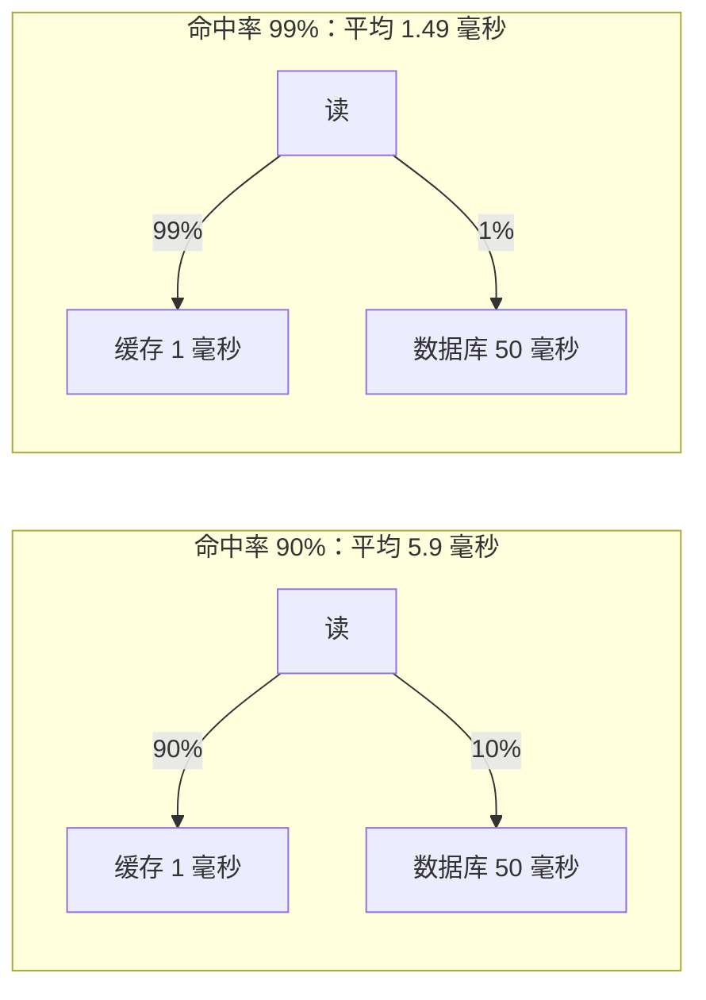

## Q
**缓存 · 命中率的数字账**｜考点 · 必会
缓存读 1 毫秒，数据库读 50 毫秒。命中率 90% 与 99% 时，平均读延迟各是多少？数据库承受的读流量各剩多少？

## A
- **90%：** 0.9 × 1 + 0.1 × 50 = 5.9 毫秒（更精确地，未命中还要先查缓存再查库再回填，会略高）；数据库承受 10% 的读流量。
- **99%：** 0.99 × 1 + 0.01 × 50 = 1.49 毫秒；数据库只承受 1%。

- **启示：** 命中率从 90% 到 99% 只多 9 个百分点，数据库读压力却降为十分之一，延迟降到约四分之一。数据库要扛的是未命中量，所以高命中率比缓存本身更重要。
- **反面：** 命中率掉到 80% 时库的负载是 99% 时的 20 倍，这就是缓存冷启动或键空间扩大后数据库突然被压垮的原因。
